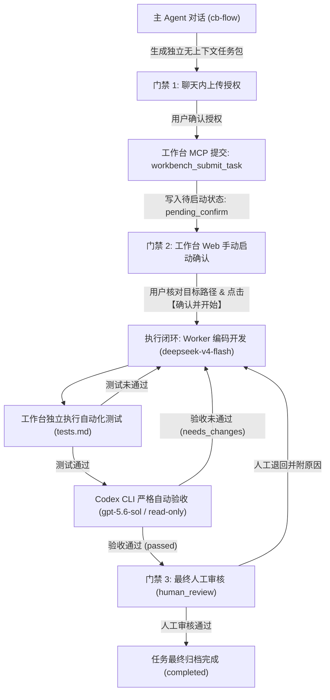

# CBWorkBench 多 Agent 开发工作台

> 从零构建的单机单用户、串行执行、强门禁保障的多 Agent 协作开发工作台。  
> 核心实现 Worker（WorkBuddy / `deepseek-v4-flash`）编码开发、独立测试执行与 Verifier（Codex CLI / `gpt-5.6-sol` 只读沙箱）自动验收，以及严格的人工双重核对确认机制。

---

## 🌟 核心理念与三道门禁

在传统的 Agent 开发流中，直接修改代码或自动循环极易产生失控。CBWorkBench 设立了**三道独立物理门禁**：



### 1. 门禁一：主 Agent 对话内上传授权
- 主 Agent 使用 `cb-flow` 技能分析当前项目上下文，生成完整的本地任务包。
- 只有向用户展示任务包摘要与目标，并获得用户明确同意后，主 Agent 才会调用 MCP 接口上传。

### 2. 门禁二：工作台 Web 手动启动确认（待启动确认）
- 任务上传后状态为 `pending_confirm`。
- **工作台 MCP 严禁提供任何启动任务的 Tool**，防止 Agent 擅自自启。
- 用户必须在 Web 控制台中亲自核对任务所属的工作目录（`target_cwd`）及 Git 变更状态，点击 **【确认并开始】** 按钮后，后台才开始串行调度。

### 3. 门禁三：最终人工审核门禁（最终人工审核）
- Worker 开发修复、独立测试命令与 Codex 自动验收全通过后，任务进入 `human_review`。
- 用户在 Web 控制台查阅代码完整 Working Tree Diff、各轮次运行记录和 Codex 验收报告。
- 用户点击 **【通过并完成】** 正式结项；或点击 **【退回修改】** 输入重修反馈，驱动引擎进入下一轮闭环修复。

---

## 🤖 角色分工与模型配置

| 角色 | 接入实现 | 模型 | 沙箱与权限 | 职责说明 |
| :--- | :--- | :--- | :--- | :--- |
| **主 Agent** | 聊天对话端 | 用户当前模型 | 规划与协调 | 理解需求，生成无上下文独立任务包，获得授权后提交工作台。 |
| **Worker (开发者)** | WorkBuddy MCP (`run_workbuddy_task`) | `deepseek-v4-flash` | 本地工作区读写 | 依据当前轮次提示词、上一轮测试失败摘要或验收问题，修改业务代码。 |
| **Test Runner** | 工作台本地独立子进程 | 原生进程 | 超时熔断执行 | 独立执行项目构建与测试命令（如 `npm test`），不依赖 Worker 自测声称。 |
| **Verifier (验收者)** | Codex CLI (`codex exec`) | `gpt-5.6-sol` | `-s read-only` 严格只读沙箱 | 检查代码快照、Diff 与测试证据，依据 JSON Schema 输出判定（通过/退回/阻断）。 |
| **Human (最终审核)** | Web 控制台 UI | 人类用户 | 最终决定权 | 核验实际运行效果与界面展示，确认无误后结项或退回。 |

---

## 🚀 快速启动

### 1. 环境准备
CBWorkBench 内置跨运行时自检测引擎（`nodeResolver.js`）：
- 系统默认 Node 18 或更高版本均可。
- 若系统 Node 缺少原生 `node:sqlite`（如 Node 18），启动器会自动查找并桥接调用本地安装的 Node 24 运行时（位于 `.cache/codex-runtimes`），原生支持 `--experimental-strip-types`。

### 2. 安装依赖
```bash
npm install
```

### WorkBuddy 适配器与登录诊断

Worker 和 Reviewer 共用 `WorkBuddyAdapter`。默认 `CB_WORKBUDDY_BACKEND=auto`：优先连接
`workbuddy-desktop`，连接或工具检查失败且尚未派发任务时才尝试 `workbuddy-cli`。
任务已经派发后不会自动换后端重跑，防止重复改动工作区。可显式设为 `desktop` 或 `cli`。

适配器从 `%CODEX_HOME%/config.toml`（默认 `~/.codex/config.toml`）读取对应 MCP 表中的
`command`、`args`、`cwd`、`env`，不再从其他服务误取 `server.js`。支持普通/字面量字符串、
多行字符串数组和 `enabled`；不支持的配置语法会明确报错。代理环境保持原配置，进程中显式
设置的 `WB_*`、`WORKBUDDY_*`、`CODEBUDDY_*` 优先于 MCP 配置。

也可设置 `CB_WORKBUDDY_MCP_CONFIG` 指向独立 JSON 文件，避免依赖 Codex 配置：

```json
{
  "desktop": {
    "command": "C:/path/to/python.exe",
    "args": ["-u", "C:/path/to/Codex-WorkBuddy-Desktop-Bridge/launch.py"],
    "cwd": "C:/path/to/tasks",
    "env": { "WORKBUDDY_CONFIG_DIR": "C:/Users/your-name/.workbuddy" }
  },
  "cli": {
    "command": "C:/path/to/node.exe",
    "args": ["C:/path/to/workbuddy-mcp/server.js"],
    "env": {
      "WB_COMMAND": "C:/path/to/node.exe",
      "WB_CLI_SCRIPT": "C:/path/to/WorkBuddy/resources/app.asar.unpacked/cli/bin/codebuddy",
      "CODEBUDDY_CONFIG_DIR": "C:/Users/your-name/.workbuddy"
    }
  }
}
```

桌面模式依赖已安装的 `Codex-WorkBuddy-Desktop-Bridge` 及其 Python 依赖。本项目的兼容启动器
在当前进程中加载桥接器，支持空闲桌面尚无 ACP Host 的情况、仅包含 `lite-wb` 的安装包，并
保留底层拒绝原因。任务以 `port=0` 请求 sidecar 分配端口，触发原生加密凭据握手；固定端口
会绕过该握手，导致已有登录态仍因 `missing-key` 被当成未登录。适配器不读取或复制认证文件、
令牌或加密密钥，也不修改桥接器安装目录。该兼容层基于现有桥接器内部接口，升级桥接器后
应重新运行真实验证；`CB_WORKBUDDY_IDLE_COMPAT=false` 可使用原始启动方式。

```powershell
# 只验证 MCP 工具和桌面 sidecar 连接，不证明模型登录态有效
node bin/workbuddy.js status

# 真实调用，只要求返回标记；退出码 0 且 verified=true 才表示执行成功
node bin/workbuddy.js verify

# 完整 CLI 的交互式登录，使用任务相同的配置目录
node bin/workbuddy.js login

# 真实 Worker 写文件、Reviewer 验收及错误产物退回验证（只修改 data 下新建的测试目录）
node bin/test-runner.js tests/workbuddyLiveSmoke.ts
```

如果返回 `AUTH_REQUIRED`，需要完成登录或修复当前配置目录对应的登录态。
桌面端登录不保证独立 CLI 登录态可用。仅含 `lite-wb` 的 WorkBuddy 安装没有交互式 CLI，
登录命令会明确提示使用桌面端或完整 CLI，不能用强制 bundle 环境变量补出缺失的交互界面。
鉴权失败、超时、取消、协议异常都会如实返回；Reviewer 仅接受符合结构的 JSON 判定，
不会根据测试摘要或“通过”等文本自动放行，也不会生成替代业务产物。

修复配置或登录后重启工作台进程加载新代码，再由用户在控制台重新确认启动受阻任务。
诊断命令不会启动、完成或审核已有业务任务。

### 3. 启动 Web 控制台与后台服务
```bash
npm start
# 服务默认常驻端口: 3721
```
启动成功后，浏览器打开：
👉 **Web 访问地址**：[http://127.0.0.1:3721](http://127.0.0.1:3721)

### 4. 运行测试套件
运行完整的单元测试与集成测试验证（100% 通过）：
```bash
npm test
```

---

## 🔌 配置 MCP 服务供主 Agent 调用

CBWorkBench 提供了标准 Stdio MCP 服务 `bin/cb-workbench-mcp.js`。

### MCP 配置示例
在你的 Codex / Claude / Antigravity 的 MCP 配置文件中加入：

```json
{
  "mcpServers": {
    "cb-workbench": {
      "command": "node",
      "args": ["D:\\CODE\\AI\\CBWorkBench\\bin\\cb-workbench-mcp.js"]
    }
  }
}
```

### MCP 提供的可用工具
- `workbench_submit_task`: 上传完整任务包，任务进入【待启动确认】状态，返回任务详情链接。
- `workbench_revise_task`: 提交任务包的新版本修订（如补充用例或调整需求）。
- `workbench_get_task_status`: 查询任务当前状态（`pending_confirm`、`running`、`human_review`、`blocked` 等）。
- `workbench_get_task_artifacts`: 读取最新一轮代码变更差异 Diff、测试运行结果与 Codex 验收结论。

> **安全约定**：MCP 绝不包含 `start_task` 或 `approve_task` 接口。

---

## 💻 Web 控制台主要功能

访问 [http://127.0.0.1:3721](http://127.0.0.1:3721) 可获得以下完整交互体验：
1. **状态筛选与任务看板**：
   - 快速筛选“全部”、“待确认”、“执行中”、“待审核”、“已完成”和“异常”。
2. **门禁二（启动确认卡片）**：
   - 展示任务计划绑定的工作区目录及 Git HEAD Commit、分支与未提交变更统计。
   - 支持用户修改修正确认目录，点击 **【确认并开始】**。
3. **门禁三（人工审核横幅与退回模态框）**：
   - 验收通过后，顶部显眼展示人工审核提示。
   - 点击 **【通过并完成】** 结项。
   - 点击 **【退回修改】** 唤起弹窗，支持填写详细问题与修改指导，一键派发新一轮修复。
4. **多阶段 Stepper 状态条**：
   - 实时指示 Worker 开发 -> 独立测试 -> Codex 验收 -> 人工审核全流程。
5. **代码 Working Tree Diff 审查器**：
   - 原生语法着色（绿增红删），展示项目自任务启动以来的代码全量变动。
6. **执行轮次与详细材料查阅**：
   - 折叠时间轴查阅每一轮的 Worker 提示词、Worker 实际输出、自动化测试输出、Codex 判定理由及全量任务材料。
7. **运行环境与 CLI 探测页面 (`/runtime`)**：
   - 查看工作台检测到的所有 CLI（WorkBuddy Desktop 桌面桥接、WorkBuddy CLI MCP、Codex CLI、Node.js 运行时与 Git）。
   - **交互式提示词探测控制台**：支持自选 CLI 与模型，使用简单提示词或一键预设（标准回声、PONG、身份问答等）即时探测连通性，秒级输出回包响应、耗时指标及鉴权诊断建议。

---

## 📡 REST API 接口定义

| 端点 | 方法 | 说明 |
| :--- | :---: | :--- |
| `/api/system/status` | `GET` | 查询工作台系统状态、Node 版本、Worker/Verifier 模型及并发占用 |
| `/api/runtime/clis` | `GET` | 查询当前工作台检测并配置的各类 CLI 工具与就绪状态 |
| `/api/runtime/probe` | `POST` | 使用自定义或预设提示词对指定 CLI 发起可用性与连通性即时探测 |
| `/api/tasks` | `GET` | 获取任务列表（支持 `?status=` 过滤） |
| `/api/tasks/:id` | `GET` | 获取指定任务详情、版本材料、轮次、测试记录、验收记录与 Diff 快照 |
| `/api/tasks/:id/confirm-start` | `POST` | 门禁二：手动确认并启动任务（可选入参 `{ confirmed_cwd }`） |
| `/api/tasks/:id/stop` | `POST` | 请求立即终止当前正在执行的任务 |
| `/api/tasks/:id/human-review` | `POST` | 门禁三：提交人工决议 `{ action: "approve" \| "reject", reason: "..." }` |

---

## 📖 工程文档与开发边界

本项目将所有 Markdown 文档集中收敛至 [`docs/`](./docs/README.md) 目录，并在工程上严格实施单分支策略：

* **追踪分支**：本仓库唯一主干分支为 `master`，直接追踪远端 `origin/master`。开发过程**不需要也不切分多个分支**。
* **开发边界规范**：详细约定了系统定位边界、三道硬门禁、Worker 工作区读写边界与 Codex 只读沙箱原则，详见 [**`docs/BOUNDARIES.md`**](./docs/BOUNDARIES.md)。
* **总体架构与流程**：详见 [**`docs/ARCHITECTURE.md`**](./docs/ARCHITECTURE.md)。

---

## 📂 项目工程结构

```text
CBWorkBench/
├── bin/
│   ├── cb-workbench.js       # 工作台后台服务与 Web 站点启动器
│   ├── cb-workbench-mcp.js   # Stdio MCP 服务启动器
│   └── test-runner.js        # 自动化测试套件执行器
├── docs/                     # 集中存放所有 Markdown 文档与规范
│   ├── README.md             # 文档目录索引与工程指南
│   ├── BOUNDARIES.md         # 开发边界与追踪分支规范 (单分支策略/三道门禁/权限边界)
│   └── ARCHITECTURE.md       # 从零版总体架构与使用流程完整说明
├── src/
│   ├── adapters/             # 多 Agent 多态适配器中心 (WorkBuddy CLI / Codex CLI)
│   ├── config/
│   │   └── constants.ts      # 常量、状态枚举与默认配置定义
│   ├── server/
│   │   ├── httpServer.ts     # 原生 Resident HTTP API 与静态 UI 服务器
│   │   └── mcpServer.ts      # Stdio MCP 服务实现 (4 大安全 Tools)
│   ├── services/
│   │   ├── gitService.ts     # Git 工作区探测与全量 Diff 快照生成
│   │   ├── testRunner.ts     # 独立自动化测试解析器与超时熔断执行器
│   │   ├── workbuddyClient.ts# WorkBuddy MCP 客户端 (deepseek-v4-flash)
│   │   ├── codexVerifier.ts  # Codex CLI 验收客户端 (gpt-5.6-sol / read-only)
│   │   ├── runtimeService.ts # 适配器状态检测与提示词即时探测服务
│   │   └── workflowEngine.ts # 核心串行循环状态机、预算控制与门禁调度
│   ├── storage/
│   │   ├── db.ts             # 基于 node:sqlite 的关系数据存储层
│   │   └── fileStore.ts      # 任务包 Markdown 材料与 Artifacts 文件系统
│   ├── ui/
│   │   ├── index.html        # 现代 Web 控制台 HTML5 结构 (包含适配器中心)
│   │   ├── styles.css        # 深色主题现代化 CSS
│   │   └── app.js            # 响应式轮询与交互业务逻辑
│   └── utils/
│       ├── logger.ts         # 控制台与 data/workbench.log 双输出日志器
│       └── nodeResolver.js   # 跨环境 Node.js 运行时探测器
├── skills/
│   └── cb-flow/              # 主 Agent 专用的任务包制作与上传 Skill
├── tests/                    # 完整单元与集成测试套件 (PASS 11/11)
├── data/                     # 运行时 SQLite 数据库与任务包持久化目录 (已清空测试数据)
└── package.json
```

---

## 📜 许可证

本项目依据内部分布式 Agent 协同规范从零开发，遵循 MIT 协议。
