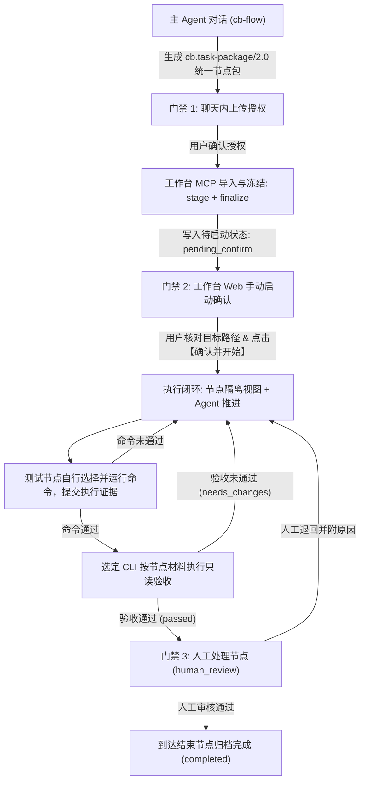

# CBWorkBench 多 Agent 开发工作台

> 从零构建的单机单用户、串行执行、强门禁保障的多 Agent 协作开发工作台。  
> 通过 WorkBuddy、Codex、Antigravity 的独立 CLI 统一对话接口完成开发与验收；保留独立测试和人工确认，不需要启动桌面客户端。

---

## 🌟 核心理念与三道门禁

在传统的 Agent 开发流中，直接修改代码或自动循环极易产生失控。CBWorkBench 设立了**三道独立物理门禁**：



### 1. 门禁一：主 Agent 对话内上传授权
- 工作流设计时请仔细填写每个节点的名称和描述（均必填）。主 Agent 根据这些信息和本次需求生成任务包及各节点的 `prompt.md`；自动节点的执行器和模型在任务页面确认，不在工作流模板中配置。
- 只有向用户展示任务包摘要与目标，并获得用户明确同意后，主 Agent 才会调用 MCP 接口上传。

### 2. 门禁二：工作台 Web 手动启动确认（待启动确认）
- 任务上传后状态为 `pending_confirm`。
- **工作台 MCP 严禁提供任何启动任务的 Tool**，防止 Agent 擅自自启。
- 用户必须在 Web 控制台中亲自核对任务所属的工作目录（`target_cwd`）及 Git 变更状态，点击 **【确认并开始】** 按钮后，后台才开始串行调度。

### 3. 门禁三：最终人工审核门禁（最终人工审核）
- 开发修复、测试节点提交的执行证据与选定 CLI 的自动验收全通过后，任务进入 `human_review`。
- 用户在 Web 控制台查阅代码完整 Working Tree Diff、各轮次运行记录和验收报告。
- 用户点击 **【通过并完成】** 正式结项；或点击 **【退回修改】** 输入重修反馈，驱动引擎进入下一轮闭环修复。

---

## CLI 对话能力

WorkBuddy、Codex 和 Antigravity 都实现同一个 IAgentAdapter.execute()。开发、验收或普通问答由提示词决定；适配器不限制角色，不设置沙箱。权限与行为边界说明、安装和调用命令见 [CLI 接入与验证](docs/CLI接入与验证.md)。

---

## 🚀 快速启动

Windows 便携版可直接双击 `cb-workbench.exe`。首次运行会在 EXE 旁创建 `data`，其中保存数据库、任务材料及本地文件。换目录或换电脑时，关闭工作台后一起复制 EXE 和整个 `data`。打包、旧版数据迁移和 MCP 配置见 [EXE 打包指南](docs/EXE打包指南.md)。

### 1. 环境准备
CBWorkBench 内置跨运行时自检测引擎（`nodeResolver.js`）：
- 源码运行需要 Node 24+ 和 `npm install` 安装的工作台依赖；本次验证版本为 Node 24.22.1。只有 Codex CLI 并不足以运行工作台。
- 启动器可探测已存在的兼容 Node 24 运行时，也可通过 `CB_NODE_PATH` 指定；找不到时须先安装运行时。

### 2. 安装依赖
```bash
npm install
```

### 统一 CLI 安装与验证

详见 [CLI 接入与验证](docs/CLI接入与验证.md)。已有 Codex 时直接检查，无需安装其他两家 CLI：

```powershell
node bin/agent.js list
.\bin\check-codex.ps1
npm start
# 在运行时页面点击 Codex 的“验证真实对话”
```

入口检查与真实对话验证分开；三家都通过 UTF-8 stdin 接收完整提示词。WorkBuddy 首次使用需独立 CLI 登录，不能假定桌面版加密凭据可以直接复用。

### 3. 启动 Web 控制台与后台服务

可以通过一键启动脚本快速运行：
- **Windows (双击或终端运行)**: `start.bat` 或 `.\start.ps1`
- **npm 命令**:
```bash
npm start
# 服务默认常驻端口: 3721
```
启动成功后，浏览器打开：
👉 **Web 访问地址**：[http://127.0.0.1:3721](http://127.0.0.1:3721)

### 4. 运行测试套件
运行离线单元和集成测试；默认使用独立临时数据库：
```bash
npm test
```

---

## 🔌 配置 MCP 服务供主 Agent 调用

CBWorkBench 提供了标准 Stdio MCP 服务 `bin/cb-workbench-mcp.js`。

### MCP 配置示例
在你的 Codex / Claude / Antigravity 的 MCP 配置文件中加入：

```json
{
  "mcpServers": {
    "cb-workbench": {
      "command": "node",
      "args": ["D:\\CODE\\AI\\CBWorkBench\\bin\\cb-workbench-mcp.js"]
    }
  }
}
```

### MCP 提供的可用工具
- `workbench_get_package_protocol`: 查询 `cb.task-package/2.0` 协议规范、限制、传输能力（仅 `local_path`）、实例 ID 与实际数据目录。
- `workbench_list_workflows` / `workbench_get_workflow`: 获取工作流列表、定义摘要（`definition_sha256`）、安全目录名及各任务节点统一材料契约。
- `workbench_stage_package` / `workbench_finalize_package`: 通过 `local_path` 暂存校验并原子冻结不可变修订版本（支持 `validate_only`），任务进入【待启动确认】状态。
- `workbench_get_package` / `workbench_get_node_context`: 按幂等键、修订或节点执行凭据分页读取材料，严格隔离各节点私有文件。
- `workbench_get_task_status` / `workbench_get_task_artifacts`: 查询任务当前节点、状态、变更 Diff、节点产物及命令/验收证据。
- `workbench_delete_task`: 调用统一可恢复清理服务（若常驻后台存活则委托后台执行）。
- `workbench_advance_workflow`: 运行中 Agent 报告当前节点结果，由后台按工作流连线统一推进。

> **安全约定**：MCP 绝不包含 `start_task` 或 `approve_task` 接口。

---

## 💻 Web 控制台主要功能

访问 [http://127.0.0.1:3721](http://127.0.0.1:3721) 可获得以下完整交互体验：
1. **状态筛选与任务看板**：
   - 快速筛选“全部”、“待确认”、“执行中”、“待审核”、“已完成”和“异常”。
2. **门禁二（启动确认卡片）**：
   - 展示任务计划绑定的工作区目录及 Git HEAD Commit、分支与未提交变更统计。
   - 支持用户修改修正确认目录，点击 **【确认并开始】**。
3. **门禁三（人工审核横幅与退回模态框）**：
   - 验收通过后，顶部显眼展示人工审核提示。
   - 点击 **【通过并完成】** 结项。
   - 点击 **【退回修改】** 唤起弹窗，支持填写详细问题与修改指导，一键派发新一轮修复。
4. **多阶段 Stepper 状态条**：
   - 实时指示 Worker 开发 -> 独立测试 -> Codex 验收 -> 人工审核全流程。
5. **代码 Working Tree Diff 审查器**：
   - 原生语法着色（绿增红删），展示项目自任务启动以来的代码全量变动。
6. **执行轮次与详细材料查阅**：
   - 折叠时间轴查阅每一轮的 Worker 提示词、Worker 实际输出、自动化测试输出、Codex 判定理由及全量任务材料。
7. **运行环境与 CLI 探测页面 (`/runtime`)**：
   - 查看工作台检测到的所有 CLI（Codex、WorkBuddy 和 Antigravity 原生 CLI；其他 CLI 缺失不阻断 Codex）。
   - **交互式提示词探测控制台**：支持自选 CLI 与模型，使用简单提示词或一键预设（标准回声、PONG、身份问答等）即时探测连通性，秒级输出回包响应、耗时指标及鉴权诊断建议。

---

## 📡 REST API 接口定义

| 端点 | 方法 | 说明 |
| :--- | :---: | :--- |
| `/api/system/status` | `GET` | 查询工作台系统状态、Node 版本、实例 ID、数据目录及并发占用 |
| `/api/system/instance` | `GET` | 查询当前常驻后台实例标识 (`instance_id`) 与绝对数据目录 (`data_dir`) |
| `/api/runtime/clis` | `GET` | 查询当前工作台检测并配置的各类 CLI 工具与就绪状态 |
| `/api/runtime/probe` | `POST` | 使用自定义或预设提示词对指定 CLI 发起可用性与连通性即时探测 |
| `/api/tasks` | `GET` | 获取任务列表（支持 `?status=` 过滤） |
| `/api/tasks/:id` | `GET` | 获取指定任务详情、Manifest、节点文件索引、执行记录与 Diff 快照 |
| `/api/tasks/:id/revisions/:rev/resource` | `GET` | 分页安全读取指定修订中的节点/共同材料文件 |
| `/api/tasks/:id/confirm-start` | `POST` | 门禁二：手动确认并启动任务（可选入参 `{ confirmed_cwd }`） |
| `/api/tasks/:id/stop` | `POST` | 请求立即终止当前正在执行的任务 |
| `/api/tasks/:id/human-review` | `POST` | 门禁三：提交人工决议 `{ action: "approve" \| "reject", reason: "..." }` |

---

## 📖 工程文档与开发边界

本项目将所有 Markdown 文档集中收敛至 [`docs/`](./docs/README.md) 目录，并在工程上严格实施单分支策略：

* **追踪分支**：本仓库唯一主干分支为 `main`，直接追踪远端 `origin/main`。开发过程**不需要也不切分多个分支**。
* **开发边界规范**：详细约定了系统定位边界、三道硬门禁、Worker 工作区读写边界与 Codex 只读沙箱原则，详见 [**`docs/BOUNDARIES.md`**](./docs/BOUNDARIES.md)。
* **总体架构与流程**：详见 [**`docs/ARCHITECTURE.md`**](./docs/ARCHITECTURE.md)。

---

## 📂 项目工程结构

```text
CBWorkBench/
├── bin/
│   ├── cb-workbench.js       # 工作台后台服务与 Web 站点启动器
│   ├── cb-workbench-mcp.js   # Stdio MCP 服务启动器
│   └── test-runner.js        # 自动化测试套件执行器
├── docs/                     # 集中存放所有 Markdown 文档与规范
│   ├── README.md             # 文档目录索引与工程指南
│   ├── BOUNDARIES.md         # 开发边界与追踪分支规范 (单分支策略/三道门禁/权限边界)
│   └── ARCHITECTURE.md       # 从零版总体架构与使用流程完整说明
├── src/
│   ├── adapters/             # WorkBuddy / Codex / Antigravity 共用对话接口
│   ├── config/
│   │   └── constants.ts      # 常量、状态枚举与默认配置定义
│   ├── server/
│   │   ├── httpServer.ts     # 原生 Resident HTTP API 与静态 UI 服务器
│   │   └── mcpServer.ts      # Stdio MCP 服务实现
│   ├── services/
│   │   ├── gitService.ts     # Git 工作区探测与全量 Diff 快照生成
│   │   ├── testRunner.ts     # 独立自动化测试解析器与超时熔断执行器
│   │   ├── cliConfig.ts      # 三家独立 CLI 启动配置
│   │   ├── cliRunner.ts      # UTF-8 子进程、超时和取消
│   │   ├── acceptanceService.ts # 验收提示词与业务结果校验
│   │   ├── runtimeService.ts # 适配器状态检测与提示词即时探测服务
│   │   └── workflowEngine.ts # 核心串行循环状态机、预算控制与门禁调度
│   ├── storage/
│   │   ├── db.ts             # 基于 node:sqlite 的关系数据存储层
│   │   └── fileStore.ts      # 任务包 Markdown 材料与 Artifacts 文件系统
│   ├── ui/
│   │   ├── index.html        # 现代 Web 控制台 HTML5 结构 (包含适配器中心)
│   │   ├── styles.css        # 浅色主题现代化 CSS
│   │   └── js/               # 模块化前端交互逻辑 (main.js / api.js / components/)
│   └── utils/
│       ├── logger.ts         # 控制台与 data/workbench.log 双输出日志器
│       └── nodeResolver.js   # 跨环境 Node.js 运行时探测器
├── skills/
│   └── cb-flow/              # 主 Agent 专用的任务包制作与上传 Skill
├── tests/                    # 离线回归与显式真实 CLI 测试
├── data/                     # 运行时配置、CLI、数据库、任务包和验证报告
└── package.json
```

---

## 📜 许可证

本项目依据内部分布式 Agent 协同规范从零开发，遵循 MIT 协议。

### 单次执行与首次使用

源码版需要 Node 24+、Git 和项目依赖（`npm install`）。已有 Codex 时无需重装：先启动工作台检查入口与版本，再在运行时页面点击“验证真实对话”。认证失败时在原生终端运行 `codex login`；不读取或展示 token。默认模型“沿用CLI配置”不传 `-m`。选定项目后依照 MCP 配置上传完整任务包，在网页确认目录、执行器和单次执行超时时间，最终仍需人工审核。

单次默认60分钟，范围1–1440整数分钟。每次 Agent 节点执行独立计时，节点内选择和运行测试命令也包含在该时限内；最多轮次规则继续生效。5分钟无输出仅提醒，任何输出都不延长硬上限。超时保留文件改动与输出，受阻后须人工重新确认，重试不恢复原CLI会话。

当前 Codex 参数包含 `--dangerously-bypass-approvals-and-sandbox`：命令具有当前用户权限，工作目录不构成安全隔离，验收也不具备强制只读保护。本轮保持既有权限策略。原始日志属于敏感本地材料，任意输出无法保证自动脱敏。

参考：[Codex 非交互模式](https://learn.chatgpt.com/docs/non-interactive-mode)。本轮提供源码运行，无发行包、内置运行时或安装器。
