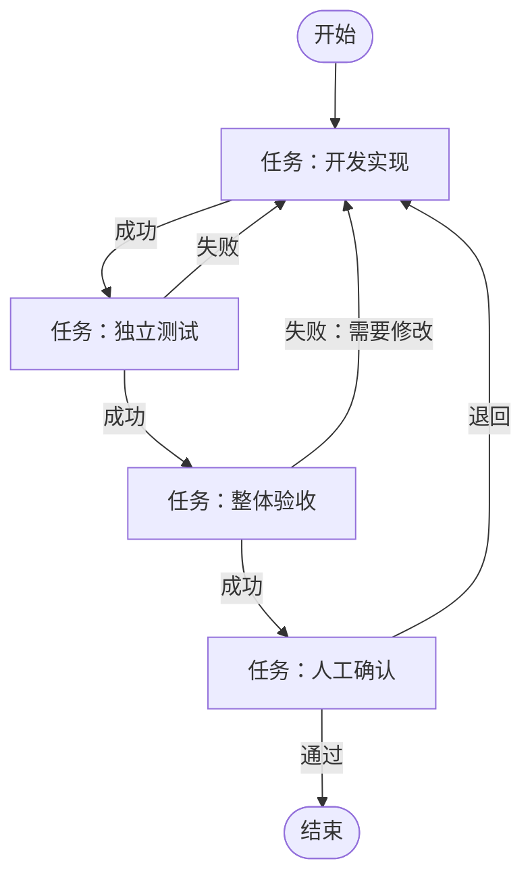

# 工作流编排与 MCP 最小版本重构方案

日期：2026-11-09。状态：方案设计，尚未批准开发。

## 1. 确定的技术方案

采用**数据库驱动的单任务状态机**，节点类型只有“开始、结束、任务”。任务节点配置“成功去向”和“失败去向”，后台依据真实执行结果更新数据库中的当前节点，再进入对应节点。

| 层面 | 确定选择 |
| --- | --- |
| 后台 | 沿用现有 Node.js / TypeScript，不引入工作流框架 |
| 状态存储 | 沿用现有 SQLite，使用短事务维护节点状态和当前节点指针 |
| 工作流结构 | 节点列表 JSON，类型为 `start`、`end`、`task`；任务节点配置 `on_success`、`on_failure` |
| 连线编辑 | 沿用原生 JavaScript，使用 SVG 显示连线；点击出口再点击目标节点，同时提供目标节点下拉框 |
| 调度方式 | 现有常驻后台统一负责，一次只运行一个自动节点 |
| Agent 执行 | 复用现有 CLI Adapter、进程管理、测试和验收能力 |
| MCP | 读取工作流节点、提交节点提示词、报告当前节点完成；推进操作转发给常驻后台 |
| 重复上限 | 每个任务节点默认最多执行 3 次，首次执行计入；次数持久化到数据库 |
| 界面 | 白色、蓝色与中性灰；左侧边栏包含“任务”“工作流”“CLI 连接”三个页面入口 |

不引入 React Flow、BPMN、Redis、消息队列或表达式引擎。第一版是带成功／失败连线的状态机，连线可以向前，也可以返回已经执行过的节点。

## 2. 工作流与连线规则

### 2.1 默认流程



这直接覆盖“整体验收不通过，返回开发，再测试，再验收”的要求。

### 2.2 任务节点的成功／失败出口

以下字段是拟新增的配置，不是当前已有字段：

```json
{
  "id": "acceptance",
  "name": "整体验收",
  "type": "task",
  "execution_mode": "agent",
  "result_rule": "acceptance",
  "executor": "codex",
  "model": "default",
  "prompt": "依据任务标准和本轮测试证据进行验收。",
  "max_executions": 3,
  "on_success": "human_review",
  "on_failure": "development"
}
```

- `on_success`：节点成功后进入哪个节点。
- `on_failure`：节点业务失败后进入哪个节点。
- 失败去向为空：暂停任务，由用户处理。
- 人工确认通过或退回：分别沿该任务节点的成功或失败连线推进，不直接把整个流程标记为完成。
- 进入结束节点：才将整个工作流实例标记为完成。
- Agent 只能报告结果，不能在调用时临时指定下一节点；后台严格使用已确认的连线。

支持成功或失败后返回指定节点。返回节点时创建新的执行记录，不覆盖上一次执行，也不复用该节点的成功状态。

### 2.3 严格只有三种节点类型

| 节点类型 | 用途 | 连线规则 |
| --- | --- | --- |
| 开始 `start` | 工作流唯一入口，不执行业务操作 | 没有入线，只有一个后继任务节点 |
| 结束 `end` | 工作流唯一终点，不执行业务操作 | 可以有入线，没有出线 |
| 任务 `task` | 执行具体工作，或等待人工处理 | 成功、失败各配置一个去向，可返回其他任务节点 |

人工确认不是第四种节点类型，也不是脱离工作流的特殊审批步骤。开发、测试、验收和人工确认全部使用任务节点。

任务节点通过“执行方式”区分如何处理，不增加节点类型：

| 执行方式 | 处理方式 | 结果来源 |
| --- | --- | --- |
| Agent `agent` | 调用选定 CLI，填写执行器、模型和提示词 | 正常结束并符合结果规则；整体验收复用现有结构化验收规则 |
| 命令 `command` | 后台执行配置的命令，例如独立测试 | 实际退出码及必需测试结果 |
| 人工 `manual` | 进入等待人工状态，网页显示说明、通过和退回按钮 | 用户提交的处理结果及退回原因 |

普通 Agent 任务与验收任务共用 CLI Adapter；仅使用 `result_rule` 选择普通完成规则或现有验收规则。人工任务不选择 CLI 和模型，不要求 Agent 提示词。

默认开发交付模板保留“开发→测试→验收→人工确认→结束”，沿用现有启动与最终人工核验约定。人工任务也可以放在流程中间，其通过结果只推进到成功去向，不能隐含结束整个流程。

### 2.4 业务失败和运行故障分开

**走失败连线：**测试断言不通过、验收明确要求修改、正常执行后报告当前任务未完成。

**暂停任务：**登录失效、CLI 异常退出、协议损坏、超时、取消、进程回收未确认、缺少测试证据。

不能把所有异常都当作业务失败，否则登录故障也会反复打回开发，形成无效循环。没有实际运行测试，不能根据 Agent 的“测试通过”报告推进。

## 3. 数据库维护方式

### 3.1 最小新增三类记录

以下表名及字段均为拟议设计，正式实施时采用增量迁移，不删除旧数据。

| 表 | 关键内容 |
| --- | --- |
| `workflow_definitions` | 工作流 ID、版本、名称、节点定义 JSON、创建时间 |
| `task_workflows` | 任务 ID、冻结定义及节点提示词、当前节点、当前执行 ID、代码代次、测试通过代次、验收通过代次 |
| `workflow_node_runs` | 执行 ID、任务 ID、节点 ID、该节点第几次执行、执行状态、结果摘要、完成报告标识、关联现有运行记录、起止时间 |

复用现有 `execution_runs`、测试结果、验收结果和日志存储，不复制一套执行日志系统。

工作流发布后产生新版本；任务提交时冻结所选版本和最终提示词。编辑模板不能改变已提交任务。历史节点结果持续保留，用于查看每一次返工及原因。

开始和结束节点只负责更新当前节点及实例状态，不创建 CLI 执行或人工待办。任务节点使用同一套执行记录；人工任务以 `waiting_manual` 状态保存，用户处理后转为成功或失败。

### 3.2 推进逻辑

一次执行结束后，后台按以下顺序处理：

1. 自动任务等待当前进程结束、协议校验和进程回收完成；人工任务等待用户处理。两者都检查停止请求。
2. 根据真实执行结果或人工处理结果，判定成功、业务失败或运行故障。
3. 在一个短事务中保存本次节点结果，并读取成功／失败去向。
4. 有合法去向则更新当前节点；没有失败去向或发生运行故障则进入受阻状态。
5. 事务提交后处理当前节点：任务节点按执行方式运行或等待人工，结束节点将实例标记为完成。

事务内不运行 CLI、不等待模型，也不引入定时扫表的第二套调度机制。

先在数据库中登记本次任务节点执行，再启动进程或生成该次人工待办。正常情况下通过执行 ID、状态条件更新及唯一约束避免重复推进。进程启动后若后台崩溃，执行结果可能不确定，重启时必须暂停该次执行，由用户核对后恢复；不承诺外部代码修改具备严格一次执行语义。等待人工的记录则保持原待办，不重新创建，也不重复计次。

### 3.3 返回开发后，旧结果如何失效

采用简单的**代码代次**，无需设计复杂的图上失效传播算法：

- 每次进入可能修改代码的 Agent 节点，代码代次加一。
- 独立测试通过，记录“测试通过代次 = 当前代码代次”。
- 自动验收通过，记录“验收通过代次 = 当前代码代次”。
- 执行验收前，要求测试通过代次与当前代码代次相同。
- 默认开发交付流程在最终人工任务以及结束前，要求测试与验收通过代次均与当前代码代次相同；中间人工任务不因其执行方式而自动承担终审职责。

因此第一次验收失败返回开发后，原测试结论自然失效，必须重新测试和验收。历史记录保留，只有其作为当前完成依据的资格失效。

MVP 将普通 Agent 执行节点保守视为可能修改代码；不额外加入“模型承诺只读”的权限开关。

### 3.4 每个任务节点默认最多执行 3 次

每个任务节点保存 `max_executions`，默认值为 **3**。首次执行计入上限，即首次执行加最多两次再次执行，而不是首次执行后再重试三次。用户可以在模板节点配置中修改为正整数，任务提交后冻结该配置。

每次真正创建该节点的一次新执行记录时计数，无论是第一次到达、沿连线返回，还是用户手动重试。成功、失败和中断均不返还已经消耗的次数。轮询、重复完成报告和在同一次人工待办上等待，不增加次数。

数据库按“任务实例 ID + 节点 ID”查询已创建记录数，使用短事务在派发前检查并分配下一次执行序号，使用唯一约束避免并发重复计次；无需再维护一份可能与执行记录不一致的计数缓存。

例如开发节点已执行 3 次，第三次验收仍要求返回开发时，应在创建第 4 次开发执行之前暂停，展示“开发节点已达到 3 次上限”，保留本次验收反馈与原本要进入的目标节点。不能自动绕过该节点、清零计数或提高上限。

服务重启、页面刷新和重新确认均不清零次数；新建工作流实例才重新计数。开始和结束节点不执行业务，也不参与重复执行；连线不得返回开始节点。

取消原方案的“整个工作流默认执行 40 次”配置。逐节点限制已能约束有限节点图中的回环，第一版不叠加全局次数预算、连线次数预算和自动退避配置。现有单次执行超时和停止能力继续保留。

## 4. MCP 设计

### 4.1 查询工作流与节点

新增：

| 方法 | 输入 | 返回 |
| --- | --- | --- |
| `workbench_list_workflows` | 无 | 工作流 ID、名称、最新版本、节点数 |
| `workbench_get_workflow` | 工作流 ID，可选版本 | 开始／结束／任务节点、稳定节点 ID、任务执行方式、职责、提示词、执行器、模型、成功／失败去向、节点执行上限 |

节点 ID 由系统生成，重命名和调整布局不改变 ID。主 Agent 根据真实节点填写专用提示词，不按节点名称或数组下标猜测映射。

### 4.2 提交任务与节点提示词

扩展现有任务提交契约，以明确的契约版本区分新旧输入。新版本提交工作流 ID、版本、公共任务材料与 `node_prompts` 映射：

```json
{
  "workflow_id": "development",
  "workflow_version": 1,
  "node_prompts": {
    "development": "实现本次需求，并根据验收反馈修复。",
    "acceptance": "核对本次需求、代码变更及本轮独立测试证据。"
  }
}
```

提交时校验节点存在、节点类型和任务执行方式正确、必需提示词完整。允许使用模板中非空的默认提示词，最终生效文本必须冻结。只有执行方式为 Agent 的任务节点接收 `node_prompts`；命令方式配置实际命令，人工方式配置处理说明，开始和结束节点不接收提示词。

### 4.3 Agent 报告完成并推进

新增 `workbench_advance_workflow`：

```json
{
  "task_id": "task-example",
  "node_id": "acceptance",
  "attempt_id": "本次执行ID",
  "completion_token": "本次执行绑定的凭据",
  "request_id": "本次报告的稳定唯一标识",
  "outcome": "failed",
  "summary": "金额边界处理不正确，需要返回开发修复。"
}
```

后台根据失败连线确定返回 `development`；调用方不传下一节点。

约束如下：

- 仅适用于已经通过网页启动确认、当前正在执行且执行方式为 Agent 的任务节点。
- 校验任务、节点、执行 ID 和本次凭据，旧执行报告不能推进新执行。
- 重复请求返回原结果；同一次执行不能更换请求 ID 重复推进。
- Agent 调用时自身进程还可能运行，因此只登记报告并立即返回“已接收，等待执行结束”。不能等待调用者自身退出后才响应，也不能提前启动下一节点。
- CLI 正常退出后，后台结合报告和真实证据，统一完成本次节点并沿连线推进。
- 报告与实际验收结果矛盾时暂停；运行故障不能被“成功”报告覆盖。
- Agent 不能代替独立测试，不能批准人工确认，不能通过该方法启动待确认任务。
- 自动推进与网页手动重试共用逐节点次数检查；MCP 不得修改或重置次数。状态查询返回当前任务节点已执行次数及冻结上限。

现有三家 CLI 的统一执行接口不代表均已验证工作台 MCP 注入能力。正式实施时先选定一种实际可配置的 CLI 跑通 Agent 主动调用链路；其他 CLI 按实际验证结果标注支持程度。不能把后台在 CLI 结束后的自动推进说成 Agent 已成功调用 MCP。

## 5. 后台职责与兼容

MCP 和网页后台目前是不同进程。**所有节点推进都交给同一个常驻后台处理**，MCP 只转发完成报告，不在自己的进程中创建第二个工作流引擎。

复用现有全局执行占用，保证单任务串行；同一数据库不允许两个常驻后台同时调度。后台未启动时 MCP 返回明确提示，不另行自动创建调度器。

旧任务保持原材料、日志和原流程，通过明确的兼容路径运行。新旧任务共用执行占用。旧任务不会因数据库迁移被自动转换成新工作流，也不伪造节点历史。

任务运行中不原地修改提示词和连线。修改方案时先停止并确认进程回收，再创建明确的新修订，重新由用户核对。第一版不做执行到一半动态改图。

## 6. 前端最小范围

### 左侧边栏

主导航固定在左侧，包含三个独立页面入口：

1. **任务**：查看实例、执行进度、反馈及人工待办。
2. **工作流**：编辑开始、结束和任务节点，以及成功／失败连线。
3. **CLI 连接**：专门处理各 CLI 的连接、检测和真实对话验证。

CLI 连接不再收进设置弹窗，也不混入工作流编排页面。三个页面沿用同一套白蓝视觉。

### 工作流页面

在左侧全局边栏之外，页面主体显示 SVG 节点及连线，右侧显示当前节点配置。

- 新增节点时仅提供“开始、结束、任务”三种选择；一个流程有且只有一个开始、一个结束。
- 任务节点字段：名称、执行方式、最多执行次数（默认 3 次）。选择 Agent 后显示执行器、模型、提示词及必要结果规则；选择命令后显示命令配置；选择人工后显示处理说明。
- 开始节点只选择后继节点，结束节点无执行配置和出线，不展示 CLI、提示词及执行次数。
- 连线字段：成功后进入、失败后进入。
- 支持点击出口后点击目标节点连线，也可直接从下拉框选择去向。
- 成功用蓝色实线，失败用灰色虚线，并显示文字标签。
- 节点按固定布局排列，不做自由拖拽位置、缩放、小地图或复杂画布操作。
- 保存时检查唯一开始／结束节点、重复 ID、失效目标、开始有入线或结束有出线、不可达节点、不能到达结束的闭环，以及默认开发交付流程中绕过必需测试／验收／最终人工任务的路径。

### 任务页面

列表显示标题、工作流、当前节点、状态和更新时间。详情显示冻结连线、当前执行输出、返工原因、节点尝试历史，以及启动、停止、重试和人工处理操作。任务节点显示“已执行 1 / 3 次”等次数信息。

人工确认任务显示为图中的普通任务节点，标注“人工处理”及“等待人工”；通过或退回后按配置连线推进。只有进入结束节点，整个实例才显示为已完成。

代码差异、完整日志、测试和验收证据按需展开。独立提示词调试中心、技术状态装饰、统计大屏和批量删除主按钮不进入 MVP 主界面。

### CLI 连接页面

采用简洁列表或卡片，展示已接入 CLI 的名称、入口是否可用、登录／连接问题、真实对话验证状态和最近检查时间。

- **检查连接**：复用现有 CLI 发现与入口兼容性检测，明确区分“命令可启动”和“已验证真实对话”。
- **验证对话**：用户主动触发所选 CLI 的标准对话检查，展示成功或失败及简明原因。
- **问题处理**：显示缺失入口、登录失效或不兼容时的具体处理建议；需要原生终端登录时说明操作入口，不收集或展示账户凭据。
- 模型目录与执行器元信息复用现有能力，具体任务选择仍在节点配置中进行；连接页面不增加开放式聊天、任意提示词试验或批量模型调用。

工作流选择 CLI 时使用这里的检查结果作就绪提示。其他 CLI 尚未连接，不妨碍使用已经就绪的 CLI。

视觉固定为白色卡片、浅灰背景、蓝色操作、中性灰文字。仅必要错误少量使用红色，不给每种 Agent 和节点分配颜色。

## 7. 拟实施顺序与验收

这是后续开发顺序，不是本次已执行事项：

1. 定义开始／结束／任务三类节点、任务执行方式、逐节点执行上限、模板版本和数据库迁移。
2. 将现有固定循环调整为读取当前节点及连线的状态机，复用执行、测试、验收能力。
3. 接入工作流查询、节点提示词和 MCP 完成报告。
4. 制作 SVG 连线编辑、白蓝任务界面、左侧边栏及独立 CLI 连接页面。
5. 验证闭环、兼容性和至少一种真实 CLI 的 MCP 调用。

必须覆盖以下验收场景：

- 验收第一次失败 → 返回开发 → 重新测试 → 再次验收 → 人工完成。
- 测试失败按配置返回指定节点，修复反馈能传入下一次执行。
- 仅有开始、结束、任务三种节点；人工确认使用执行方式为人工的任务节点，不能产生第四种类型。
- 中间人工任务通过后继续进入后继任务，只有进入结束节点才完成整个实例。
- 成功连线同样可以返回指定任务节点；每个任务节点默认最多执行 3 次，首次计入。
- 第 4 次执行在派发前被拒绝并暂停；重复报告、等待人工、刷新及重启不会错误增加或清零次数。
- 旧测试结果不能用于新一轮代码验收。
- 重复报告、过期报告、取消后报告均不能重复或越级推进。
- CLI 未退出、进程未回收时，下一节点不能启动。
- 登录故障、超时和协议异常暂停，而非沿失败连线无限返工。
- 重启保留现场，不自动把不确定执行判为成功或直接重跑。
- 修改模板不改变已提交任务；旧任务和历史证据不丢失。
- 用户无需编写 JSON，即可连线、创建、启动并审核一个任务。
- 左侧边栏包含任务、工作流、CLI 连接三个入口；CLI 连接页可单独完成入口检查、真实对话验证及查看失败原因。

## 8. 本次范围

本次仅修订设计方案，不交付代码实现。不做并行分支、任意条件表达式、子工作流、多用户、远程集群、定时执行或自动 Git 提交与发布。
