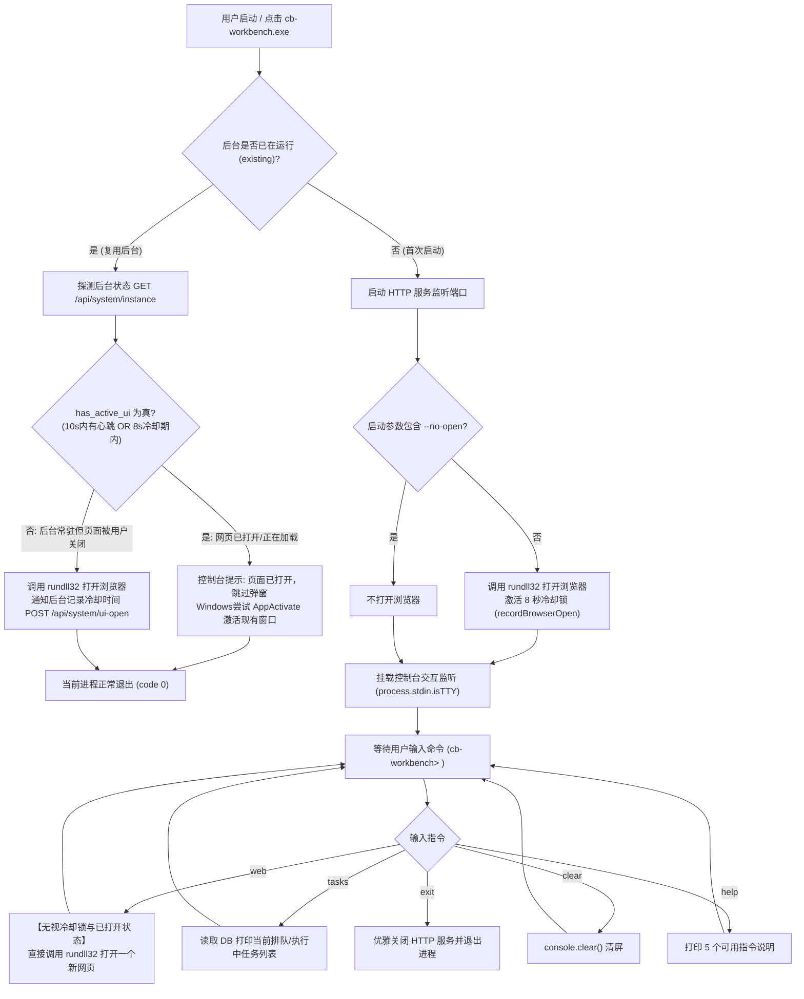

# CBWorkBench 控制台交互指令与防重复弹窗冷却锁修改方案

本方案旨在解决两个核心诉求：
1. **控制台交互化**：点击 exe 启动后的命令行黑框支持常用控制台指令，精简为严格的 5 个单一功能命令（`web`、`tasks`、`clear`、`help`、`exit`）。
2. **防重复弹窗与冷却锁**：彻底修复多机环境下双击 exe 或多实例启动时“一直弹出新网页”的 Bug；启动阶段检测网页是否已打开，保证**自动只打开一个页面**；同时保证在控制台中主动输入 `web` 指令时**始终可以打开新页面**。

---

## 一、 整体架构与流转时序



---

## 二、 关键设计原则

1. **自动打开 vs 手动指令权限分离**：
   - **自动检测打开（启动链路）**：遵循**单例保护原则**。必须同时通过“前端心跳活跃校验”与“8 秒冷却锁（Grace Period）”双重门禁。若页面已在运行或正在打开，绝不重复弹出。
   - **控制台 `web` 指令（交互链路）**：遵循**用户显式意志原则**。无视已打开状态与冷却锁，每次执行都确定性拉起一个新标签页。
2. **零外部依赖与非侵入式**：
   - 控制台使用 Node.js 原生 `node:readline` 模块，不引入额外 npm 包。
   - 交互仅在 `process.stdin.isTTY` 为真时启用，自动化测试（`stdio: ['ignore', ...]`）完全不受影响。
3. **双向生命周期同步**：
   - 前端通过定时心跳（3s）和 `beforeunload` beacon 维持活跃状态。
   - 冷却锁兜底网络微延迟与浏览器冷启动耗时。

---

## 三、 涉及文件与修改内容清单

| 序号 | 文件路径 | 类型 | 改动说明 |
| :--- | :--- | :--- | :--- |
| 1 | [`src/services/uiActivityTracker.ts`](file:///d:/CODE/AI/CBWorkBench/src/services/uiActivityTracker.ts) | **新增** | 页面心跳追踪器与 8 秒打开冷却锁单例实现 |
| 2 | [`src/server/httpServer.ts`](file:///d:/CODE/AI/CBWorkBench/src/server/httpServer.ts) | 修改 | 增加 `/api/system/ui-heartbeat` 与 `/api/system/ui-open` 路由，在 `/api/system/instance` 中导出 `has_active_ui` |
| 3 | [`src/config/dataDir.ts`](file:///d:/CODE/AI/CBWorkBench/src/config/dataDir.ts) | 修改 | `fetchRemoteInstanceInfo` 解析远端 `has_active_ui` 与冷却时间戳 |
| 4 | [`src/ui/js/main.js`](file:///d:/CODE/AI/CBWorkBench/src/ui/js/main.js) | 修改 | 页面加载启动 3s 心跳上报，页面卸载发送 beacon 注销 |
| 5 | [`src/entryExe.ts`](file:///d:/CODE/AI/CBWorkBench/src/entryExe.ts) | 修改 | 启动判断防重复弹窗逻辑，并在服务常驻时挂载 5 个控制台指令 |
| 6 | [`tests/uiActivityTracker.test.ts`](file:///d:/CODE/AI/CBWorkBench/tests/uiActivityTracker.test.ts) | **新增** | 针对心跳检测、会话注销、冷却锁时间窗口的单元测试 |
| 7 | [`tests/entryExe.test.ts`](file:///d:/CODE/AI/CBWorkBench/tests/entryExe.test.ts) | 修改 | 验证多次启动时复用且不重复弹出，测试与 CLI 的兼容性 |

---

## 四、 具体代码实现方案

### 1. 新增 `src/services/uiActivityTracker.ts`
负责心跳维护与打开冷却锁判定：

```typescript
export class UiActivityTracker {
  private lastHeartbeatAt: number = 0;
  private lastBrowserOpenedAt: number = 0;
  private activeSessions = new Map<string, number>();
  private readonly heartbeatTimeoutMs: number = 10000; // 10秒无心跳视为断开
  private readonly openCooldownMs: number = 8000;       // 8秒防高频重复弹窗冷却锁

  recordHeartbeat(clientId: string): void {
    const now = Date.now();
    this.lastHeartbeatAt = now;
    if (clientId) this.activeSessions.set(clientId, now);
    this.cleanupExpired(now);
  }

  removeSession(clientId: string): void {
    if (clientId) this.activeSessions.delete(clientId);
  }

  recordBrowserOpen(): void {
    this.lastBrowserOpenedAt = Date.now();
  }

  getLastBrowserOpenedAt(): number {
    return this.lastBrowserOpenedAt;
  }

  /**
   * 判定页面是否已打开或处于冷启动加载宽限期
   */
  hasActiveUi(): boolean {
    const now = Date.now();
    // 1. 冷却锁判定：8秒内刚触发过打开，认定为正在打开中
    if (this.lastBrowserOpenedAt > 0 && (now - this.lastBrowserOpenedAt) < this.openCooldownMs) {
      return true;
    }
    // 2. 活跃 Session 判定
    this.cleanupExpired(now);
    if (this.activeSessions.size > 0) {
      return true;
    }
    // 3. 兜底心跳判定
    if (this.lastHeartbeatAt > 0 && (now - this.lastHeartbeatAt) < this.heartbeatTimeoutMs) {
      return true;
    }
    return false;
  }

  private cleanupExpired(now: number): void {
    for (const [id, lastSeen] of this.activeSessions.entries()) {
      if (now - lastSeen > this.heartbeatTimeoutMs) {
        this.activeSessions.delete(id);
      }
    }
  }
}

export const uiActivityTracker = new UiActivityTracker();
```

---

### 2. 改造 `src/server/httpServer.ts`
在路由中接入心跳与打开事件，扩展实例探测返回值：

```typescript
import { uiActivityTracker } from '../services/uiActivityTracker.ts';

// 1. 在 /api/system/instance 响应中添加状态
if (pathname === '/api/system/instance' && method === 'GET') {
  sendJson(res, 200, {
    success: true,
    instance_id: INSTANCE_ID,
    data_dir: DATA_DIR,
    source: DATA_DIR_SOURCE,
    legacy_data_path: LEGACY_DATA_PATH,
    pid: process.pid,
    host: addr?.address || DEFAULT_HOST,
    port: addr?.port || DEFAULT_PORT,
    has_active_ui: uiActivityTracker.hasActiveUi(),
    last_browser_opened_at: uiActivityTracker.getLastBrowserOpenedAt(),
  });
  return;
}

// 2. 新增 /api/system/ui-heartbeat
if (pathname === '/api/system/ui-heartbeat' && method === 'POST') {
  let body: any = {};
  try { body = await parseJsonBody(req); } catch {}
  const clientId = String(body.clientId || urlObj.searchParams.get('clientId') || '');
  const action = String(body.action || urlObj.searchParams.get('action') || 'ping');
  if (action === 'close') {
    uiActivityTracker.removeSession(clientId);
  } else {
    uiActivityTracker.recordHeartbeat(clientId);
  }
  sendJson(res, 200, { success: true, has_active_ui: uiActivityTracker.hasActiveUi() });
  return;
}

// 3. 新增 /api/system/ui-open
if (pathname === '/api/system/ui-open' && method === 'POST') {
  uiActivityTracker.recordBrowserOpen();
  sendJson(res, 200, { success: true, last_browser_opened_at: uiActivityTracker.getLastBrowserOpenedAt() });
  return;
}
```

---

### 3. 改造 `src/ui/js/main.js`
前端挂载 3 秒一次心跳：

```javascript
  initHeartbeat() {
    const clientId = 'ui-' + Date.now() + '-' + Math.random().toString(36).slice(2, 8);
    const sendPing = () => {
      fetch('/api/system/ui-heartbeat', {
        method: 'POST',
        headers: { 'Content-Type': 'application/json' },
        body: JSON.stringify({ clientId, action: 'ping' }),
      }).catch(() => {});
    };
    sendPing();
    setInterval(sendPing, 3000);

    window.addEventListener('beforeunload', () => {
      if (navigator.sendBeacon) {
        navigator.sendBeacon('/api/system/ui-heartbeat?action=close&clientId=' + clientId);
      }
    });
  }
```

---

### 4. 改造 `src/entryExe.ts`
实现启动防抖、窗口激活与 5 个控制台命令交互：

```typescript
import readline from 'node:readline';
import { db } from './storage/db.ts';
import { uiActivityTracker } from './services/uiActivityTracker.ts';

function openBrowser(url: string): void {
  if (process.platform === 'win32') {
    execFile('rundll32.exe', ['url.dll,FileProtocolHandler', url], { windowsHide: true }, (err) => {
      if (err) console.error(`[CBWorkBench] 无法自动打开浏览器，请手动访问 ${url}: ${err.message}`);
    });
  }
}

function tryActivateExistingWindow(title: string): void {
  if (process.platform !== 'win32') return;
  try {
    execFile(
      'powershell.exe',
      ['-NoProfile', '-NonInteractive', '-Command', `(New-Object -ComObject WScript.Shell).AppActivate("${title}")`],
      { windowsHide: true },
      () => {}
    );
  } catch {}
}

async function notifyRemoteBrowserOpened(serverUrl: string): Promise<void> {
  try {
    const normalized = serverUrl.replace(/\/+$/, '');
    await fetch(`${normalized}/api/system/ui-open`, { method: 'POST' });
  } catch {}
}

function startInteractiveConsole(url: string, server: any): void {
  if (!process.stdin.isTTY) return;

  const rl = readline.createInterface({
    input: process.stdin,
    output: process.stdout,
    prompt: 'cb-workbench> '
  });

  console.log(`💡 控制台交互已就绪。输入 'help' 查看指令，输入 'web' 打开新网页，输入 'exit' 退出服务。\n`);
  rl.prompt();

  rl.on('line', (line) => {
    const cmd = line.trim();
    switch (cmd) {
      case 'web':
        console.log(`🌐 正在打开工作台新网页: ${url}`);
        openBrowser(url);
        uiActivityTracker.recordBrowserOpen();
        break;

      case 'tasks':
        try {
          const tasks = db.listTasks();
          if (tasks.length === 0) {
            console.log('📋 当前暂无任何任务。');
          } else {
            console.log(`\n📋 当前任务列表 (共 ${tasks.length} 项):`);
            console.log('-'.repeat(60));
            console.log(`${'ID'.padEnd(24)} ${'状态'.padEnd(16)} 标题`);
            console.log('-'.repeat(60));
            for (const t of tasks.slice(0, 20)) {
              console.log(`${t.id.padEnd(24)} ${t.status.padEnd(16)} ${t.title}`);
            }
            if (tasks.length > 20) {
              console.log(`... 还有 ${tasks.length - 20} 项任务，请在 Web 界面查看`);
            }
            console.log('-'.repeat(60) + '\n');
          }
        } catch (err: any) {
          console.error(`[CBWorkBench] 查询任务失败: ${err?.message || err}`);
        }
        break;

      case 'clear':
        console.clear();
        break;

      case 'help':
        console.log(`
可用指令:
  web    - 打开工作台网页 (每次均会打开新页面)
  tasks  - 查看当前任务列表与状态
  clear  - 清空控制台屏幕
  help   - 显示此帮助信息
  exit   - 停止服务并安全退出
`);
        break;

      case 'exit':
        console.log('正在安全停止服务...');
        rl.close();
        server.close(() => process.exit(0));
        return;

      case '':
        break;

      default:
        console.log(`未知命令: '${cmd}'。输入 'help' 查看可用指令。`);
        break;
    }
    rl.prompt();
  });

  rl.on('close', () => {
    server.close(() => process.exit(0));
  });
}

// 主入口逻辑分支优化：
// 1. 如果 existing:
if (existing) {
  const remote = await fetchRemoteInstanceInfo(existing.url);
  if (remote?.has_active_ui) {
    console.log(`[CBWorkBench] 后台已在运行且工作台网页当前已打开 (${existing.url})，跳过重复打开新网页。`);
    tryActivateExistingWindow('CBWorkBench');
  } else if (!cliArgs.noOpen) {
    console.log(`[CBWorkBench] 后台已在运行，检测到网页未打开，正在启动浏览器访问: ${existing.url}`);
    openBrowser(existing.url);
    await notifyRemoteBrowserOpened(existing.url);
  }
  process.exit(0);
}

// 2. 如果首次启动:
const { startServer } = await import('./server/httpServer.ts');
const server = await startServer(port, host);
const url = `http://${host}:${port}/`;

if (!cliArgs.noOpen) {
  openBrowser(url);
  uiActivityTracker.recordBrowserOpen();
}

startInteractiveConsole(url, server);
```

---

## 五、 验证与验收方案

1. **单元测试与回归**：
   - 编写 `tests/uiActivityTracker.test.ts`，覆盖心跳超时清理、打开后 8s 内判定活跃（冷却期生效）、移除会话后判定离线等用例。
   - 运行全量 `node bin/test-runner.js`，保证现有全部 29 个测试用例保持 100% 通过。
2. **多实例启动与重复弹窗验证**：
   - 启动实例 1，验证浏览器首次正常弹出，且黑框提示 `cb-workbench>` 就绪。
   - 在 8 秒内再次运行 `cb-workbench.exe`，验证第二个进程自动复用后台，控制台输出“跳过重复打开新网页”，**浏览器不弹出第二个标签页**。
   - 浏览器保持打开状态，超过 10 秒后再次运行 `cb-workbench.exe`，依然由于前端心跳维持在活跃状态，**浏览器不弹出第二个标签页**。
3. **控制台交互验证**：
   - 在黑框中键入 `web`，回车后**成功打开一个新标签页**。
   - 键入 `tasks`，成功输出任务表格或“暂无任务”。
   - 键入 `clear`，屏幕被清空并重新显示 `cb-workbench> `。
   - 键入 `help`，打印规范帮助。
   - 键入 `exit`，后台服务正常退出，黑框关闭。

---

## 六、 健壮性与异常边界加固优化 (Review & Robustness Enhancements)

基于代码走查与审查报告，对以下异常边界与体验风险完成深度加固：
1. **Windows 窗口激活进程防早死 (Detached & Ignore stdio)**：
   - `tryActivateExistingWindow` 在调用 PowerShell `AppActivate` 时追加 `{ windowsHide: true, detached: true, stdio: 'ignore' }`，确保父 Node.js 进程退出时不会因操作系统控制台宿主（ConHost）连带终止 PowerShell 执行。
2. **Session 注销与幽灵活跃防御 (Stale Session Cleanup)**：
   - `removeSession` 在移除特定 clientId 时同步触发 `this.cleanupExpired(now)`，并根据剩余存活会话实时更新 `lastHeartbeatAt`，彻底解决客户端非正常关闭残留导致判定误判为活跃的问题。
3. **前端心跳初始化前置与反节流机制 (Visibility & Focus Heartbeat)**：
   - `initHeartbeat` 前置至前端 `App` 构造函数第一时间触发，避免受异步元数据加载挂起影响。
   - 监听 `document.visibilitychange` 与 `window.focus` 事件，当用户切回标签页或窗口获得焦点时立即补发心跳，对抗 Chromium 浏览器长期置于后台时的定时器强制节流。
4. **单次往返复用启动探测 (Single-roundtrip Instance Check)**：
   - `resolveResidentServerForDataDir` 自动将远端实例包含的 `has_active_ui` 与 `last_browser_opened_at` 回传，消除启动时的二次网络请求开销。
5. **跨平台打开浏览器兼容 (macOS/Linux/Win32 Fallback)**：
   - `openBrowser` 全面覆盖 Windows (`rundll32.exe`)、macOS (`open`) 与 Linux (`xdg-open`)，并带有未捕获异常的安全捕获与友好的终端手动访问指引。
6. **控制台类型安全与多行任务标题清洗**：
   - 控制台函数完善强类型定义（`InteractiveConsoleServer` 与 `UiActivityTracker`），在打印 `tasks` 表格时清洗标题中的换行符，防止控制台表格断裂错位。
