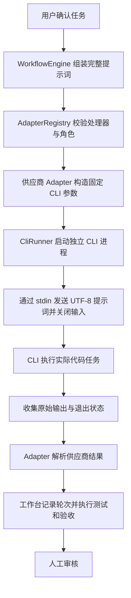

# CLI 任务分发与无客户端对话开发方案

> 用途：交给没有本次聊天上下文的 Worker 开发和验收。
> 项目：`D:\CODE\AI\CBWorkBench`；核查日期：2026-10-29；核查基线：`master / a24aafc`。
> 当前状态：仅完成方案和只读调查，尚未实现、未运行真实模型任务、未证明客户端对话零新增。
> 本文中的新增类型、文件、环境变量均为拟议设计，不代表仓库已有能力。开发前重新检查 HEAD、工作区和相关调用链。

## 1. 需求与本次决策

用户要求：实际任务通过 CLI 分发；桌面客户端中不要新增对话；后续其他处理器也遵守相同要求；CLI 必须收到完整任务提示词，中文不能乱码。

采用工作台直接启动非交互 CLI 子进程的方案，移除任务执行链对 WorkBuddy Desktop Bridge、桌面 Sidecar、外部 WorkBuddy MCP 的依赖。工作台本身接收任务包的 MCP 服务继续保留，两者用途不同。

“CLI 带上提示词”具体落实为：本次 CLI 进程通过标准输入接收完整 UTF-8 提示词，不把大段提示词拼进命令字符串或位置参数。这样仍是 CLI 执行任务，并能处理中文、多行、长文本和 shell 特殊字符。

所有 Agent 处理器，包括 Worker、Reviewer、运行环境页面的模型探测，都执行同一策略：

| 必须满足 | 实现约束 |
| --- | --- |
| CLI 执行 | 本地非交互子进程；不通过桌面 API、具名管道、ACP、客户端自动化派发 |
| 不新增客户端对话 | 禁止持久化本次 Agent 会话，并以真实客户端检查作为交付证据 |
| 不续接已有对话 | 每次重建上下文；不使用 continue/resume/fork-session/桌面会话 ID |
| 完整中文提示词 | UTF-8 stdin 输入；字节级测试证明未截断、未乱码 |
| 失败可见 | 不支持无会话执行、鉴权失败、协议异常等情况必须阻断，禁止回退桌面 |
| 可追踪 | 工作台继续保留轮次提示词、输出、测试证据和审计材料 |

会话仅在进程内存中暂时存在不违反本需求；禁止的是新增客户端可见或可恢复的持久会话。工作台自己的任务卡片、轮次记录和交付产物仍需要保留。无会话持久化不等于供应商不处理请求、不计费或不保存任何服务日志，不能扩大承诺。

## 2. 当前代码事实与证据

| 位置 | 已核查的事实 | 本次影响 |
| --- | --- | --- |
| `src/adapters/types.ts` | 定义 Worker/Reviewer 接口，Worker 输入含 taskId、roundNumber、workerId、model、prompt、cwd、timeoutMs | 尽量保持调用契约 |
| `src/adapters/registry.ts` | 注册 WorkBuddy、Codex；只有 WorkBuddy 支持 Worker；非法适配器 ID 会回退 WorkBuddy | 增加统一 CLI 策略约束，消除显式错误 ID 的静默回退 |
| `src/adapters/workbuddyAdapter.ts` | Worker/Reviewer 共用 WorkBuddyClient；Reviewer 有 JSON 判定校验 | 保留结果转换和判定逻辑 |
| `src/services/workbuddyClient.ts` | 默认 auto，先 desktop 再 cli；每次通过 stdio 启动 MCP；桌面分支调用 start/wait/cancel | 改为直接调用 CLI Runner |
| `src/services/workbuddyConfig.ts` | 读取 Codex 的 MCP 配置；支持桌面兼容启动器与 lite bundle 检测 | 改为独立 CLI 启动配置，去掉桌面和 MCP 耦合 |
| `src/services/workflowEngine.ts` | 组装每轮提示词，顺序执行 Worker→独立测试→Reviewer→人工审核 | 继续复用；只改必要的取消与审计接线 |
| `src/services/codexVerifier.ts` | 直接 spawn Codex，但 shell=true；已有 UTF-8 stdin；尚未传 --ephemeral | 接入统一 Runner，保留只读沙箱与 Schema 判定 |
| `src/services/runtimeService.ts` | 页面探测调用适配器 executeDevTask/executeReview；configured 当前写死 true | 探测走同一 CLI 路径，区分配置、能力、模型执行证据 |
| `src/ui/js/` | 当前前端业务实现所在目录；`src/ui/app.js` 是入口桥接 | 修改真实组件，避免只改旧入口 |
| `tests/workbuddyClient.test.ts` | 现有测试主要验证 MCP 和桌面回退 | 替换为真实子进程 CLI fixture 测试 |

当前默认 Worker 和 Reviewer 都是 WorkBuddy。Codex 作为已注册 Reviewer 可被选择。本次不顺手改变默认角色分工、模型或历史任务配置。

本机只读调查结果：

- `%USERPROFILE%/.codex/config.toml` 中 WorkBuddy CLI 与 Desktop MCP 均为 `enabled=false`；不得通过本需求重新启用它们。
- WorkBuddy 自带入口存在：`D:\CODE\TOOL\WorkBuddy\resources\app.asar.unpacked\cli\bin\codebuddy`。
- 该安装的 dist 仅包含 `codebuddy-lite-wb.mjs` 和对应延迟加载目录，普通启动报 `Cannot find module '../dist/codebuddy'`。
- 子进程设置 `CODEBUDDY_FORCE_LITE_WB_BUNDLE=1` 后能打印帮助，但同时出现配置拉取/代理初始化异常。不能据此认定鉴权、模型或工具调用可用。
- lite bundle 中找到 `--no-session-persistence` 参数注册及禁用持久化的判断代码；帮助界面是否展示该参数不能单独作为能力判定依据。
- 本机原生 Codex 可执行文件的 `exec --help` 明确列出 `--ephemeral`，含义是不把会话文件持久化到磁盘。

以上是当前安装的观察结果。更换 CLI 版本或路径后必须重新验证，不能将 bundle 中存在参数字符串当作端到端通过证明。

官方依据：[CodeBuddy CLI 参数](https://www.codebuddy.cn/docs/cli/cli-reference)说明 `-p` 为非交互执行，`--no-session-persistence` 控制会话不落盘；[WorkBuddy Headless 文档](https://www.workbuddy.ai/docs/cli/headless)提供 stdin 输入方式。两者支持本方案方向，但不代替本机客户端行为验收。

## 3. 范围与兼容性

### 3.1 本次包含

1. 一个轻量共用 CLI Runner，负责进程、UTF-8、超时、取消和退出结果。
2. WorkBuddy 直接 CLI 分发；默认不持久化会话，无桌面回退。
3. 现有 Codex Reviewer 同步遵守 CLI、不持久化会话、UTF-8 和无 shell 拼接规则。
4. 为后续处理器规定统一接入契约和相同验收测试。
5. 清理本仓库桌面分发入口、旧说明和旧测试；更新页面诊断信息。
6. 保留完整任务提示词、当前工作目录、修复轮次、独立测试和人工审核流程。

### 3.2 本次不包含

- 不安装或升级供应商 CLI，不改其 bundle/安装目录，不复制令牌或认证文件。
- 不修改用户的全局 Codex MCP 配置，不恢复已禁用的 MCP，不自动迁移凭据。
- 不清理供应商现有对话，不删除既有历史文件来伪装“没有新增”。
- 不更改业务任务包格式、既有适配器 ID、默认模型和默认 Reviewer。
- 不重构 TestRunner、任务状态机、任务删除、前端整体结构或模型列表。
- 不新增 npm 运行依赖，不建立通用插件平台，不增加新的供应商处理器。
- 不自动提交、推送、部署，不启动已有业务任务。

现有历史任务仍使用 `workbuddy`/`codex` ID。停用的是其旧传输实现，不删除任务或篡改历史执行记录。失败仍进入现有 blocked；取消仍使用现有 cancelled。新增底层错误码作为诊断信息，不扩展业务状态机。

## 4. 目标调用链和职责



保留 `IWorkerAdapter.executeDevTask()`、`IReviewerAdapter.executeReview()`。不要把供应商参数、输出解析、Schema 规则混入 Runner。

### 4.1 共用 Runner：拟新增 `src/services/cliRunner.ts`

输入至少包含：`runId`、`taskId`、`executable`、`args`、`cwd`、`env`、`stdin`、`timeoutMs`。runId 必须标识单次执行，不能只用 taskId，避免同任务不同轮次或页面探测互相干扰。

输出至少包含：`exitCode`、`signal`、`stdout`、`stderr`、`timedOut`、`cancelled`、`durationMs`、`errorCode`。仅成功拿到 0 退出码还不够，供应商 Adapter 需继续验证业务结果。

Runner 只做五件事：

1. 校验绝对且存在的 cwd、可启动入口、有效超时和非空输入。
2. 以 `shell:false`、`windowsHide:true`、`stdio:['pipe','pipe','pipe']` 启动。
3. 发送完整 UTF-8 输入，分别收集 stdout/stderr 原始字节。
4. 处理启动错误、stdin EPIPE、超时、取消和子进程树回收。
5. 单次终结并返回原始结果，清理定时器和活动进程登记。

runner 不重试、不切换供应商、不读取业务任务包、不判断“测试通过”，不自动开启交互终端。

### 4.2 WorkBuddyAdapter 与 WorkBuddyClient

`WorkBuddyAdapter` 继续负责 Worker 上下文映射、耗时/metadata 和 Reviewer JSON 判定。`WorkBuddyClient` 改为构造 CLI 请求和解析 CLI 响应；去掉 MCP Client、StdioClientTransport、desktop/auto 分支、远程 task_id 和桌面 cancel/wait。

任务上下文继续由 WorkflowEngine 组装。每轮新建 CLI 进程，不带 resume/continue；上轮失败原因、验收问题和人工反馈必须显式附在本轮提示词中。

### 4.3 后续处理器共同契约

在 `IAgentAdapter` 及元数据 DTO 中增加只读执行策略，例如：

```typescript
executionPolicy: {
  transport: 'cli';
  interaction: 'headless';
  promptTransport: 'stdin-utf8';
  sessionPersistence: 'disabled';
}
```

上述字段是强制策略声明，不等于已验证能力。`healthCheck()` 还要区分启动入口、版本/参数能力、鉴权/真实运行是否验证；真实运行证据包括 binary/version、使用的无会话参数和测试报告。

注册时拒绝缺失策略或声明不符合要求的处理器；任务派发前做对应能力检查。不能仅凭适配器自报支持，就在页面显示“客户端零新增已验证”。

新处理器必须复用 Runner，或者提供等价实现且通过同一套契约测试。不得在 executeReview、探测接口或后台修复路径藏入桌面/HTTP 旁路执行。

显式传入未知 ID、角色不匹配的适配器时返回配置错误；只有未填写 ID 才使用原默认值。禁止静默回退 WorkBuddy。

## 5. CLI 配置与实际参数

### 5.1 独立配置

拟新增 `CB_AGENT_CLI_CONFIG`，指向 UTF-8 JSON 文件。它是工作台 CLI 启动配置，不是 MCP 配置，也不包含提示词或凭据。示例为待实现格式：

```json
{
  "workbuddy": {
    "executable": "C:/path/to/node.exe",
    "script": "D:/path/to/WorkBuddy/resources/app.asar.unpacked/cli/bin/codebuddy",
    "env": {
      "CODEBUDDY_CONFIG_DIR": "C:/Users/your-name/.workbuddy"
    }
  },
  "codex": {
    "executable": "C:/path/to/codex.exe"
  }
}
```

文件中的路径均为示例，不得直接当作真实可执行路径。实现配置校验；同一入口支持原生可执行文件或 Node+script 两种形态。script 字段仅是入口文件，不允许借此注入额外执行标志。

优先级：显式独立配置 → 当前进程明确设置的现有 `WB_COMMAND`+`WB_CLI_SCRIPT` → 有限的本机入口探测。显式配置存在但无效时直接报错，不用其他入口掩盖错误。无需配置 Codex 时保留现有可执行文件定位能力，并将最终启动统一为无 shell 形式。

不再读取 `.codex/config.toml` 的 WorkBuddy MCP 启停状态或桌面配置来决定任务执行。对旧 `CB_WORKBUDDY_MCP_CONFIG` 和 `CB_WORKBUDDY_BACKEND` 输出清晰迁移错误，不静默忽略显式旧配置。删除本仓库桌面兼容入口前搜索所有引用。

Windows 下 `.cmd`/`.ps1` 不能简单用 shell:false 直接运行。发现包装器时解析到已知 Node 入口或原生 exe；解析不了就报 CONFIG，不能切回 shell:true。探测使用 `where.exe`/Get-Command 等已核实方式，禁止执行配置中的拼接命令字符串。

环境使用当前进程环境加受控配置，保留代理和认证目录。日志只输出允许展示的字段，不打印全部 env。对于 lite-only 安装，仅在确认文件布局匹配时在子进程内设置已有 `CODEBUDDY_FORCE_LITE_WB_BUNDLE=1`；不修改全局环境，不写供应商配置。

### 5.2 WorkBuddy 任务参数

拟采用以下参数数组，完整提示词单独走 stdin：

```text
[script（仅 Node 入口需要）,
 "-p", "--no-session-persistence",
 "--output-format", "json",
 "--model", requestedModel,
 原有已确认权限策略所需参数]
```

`--no-session-persistence` 必须得到当前版本确认；若不支持或行为验证失败，阻断任务。禁止省略后重试。禁止加入 `--ide`、`--serve`、`--acp`、`--bg`、`--remote-control`、`--resume`、`--continue` 等客户端连接、后台会话或续接参数。

JSON 外层响应不应直接当作 Worker 文本。以本机版本实际输出建立 fixture，提取最终结果，识别 is_error/失败终态等字段。不能编造字段名或依据文本中出现“成功”“通过”放行。Reviewer 再按现有 reviewSchema 验证最终判定。协议中缺失必需字段、JSON 不完整或输出为空时返回 PROTOCOL/EXECUTION。

固定本次请求模型，不读取旧 MCP 的 WB_FALLBACK_MODEL、不自动换模型。如果 CLI 提供实际模型信息就记录；否则标明“请求模型”，不能将 modelUsed 当作模型服务已确认的证据。

权限沿用已有明确配置；不得为了解决非交互卡住而新增 `CODEBUDDY_IS_SANDBOX=1`、自动放大权限或假称 cwd 是沙箱。权限拒绝应返回可诊断失败。无对话要求与文件/网络权限隔离是两条不同边界。

### 5.3 Codex Reviewer 参数

保持现有 `exec`、模型、`-s read-only`、`--output-schema`、`-o`、`-C` 和 `-` 的 stdin 协议，增加本机已确认的 `--ephemeral`，使用原生 exe 或 Node 包入口，以 shell:false 启动。

保留当前结构化输出文件和校验逻辑，防止复用上轮遗留文件：每次使用唯一 runId 的输出位置，或在启动前验证目标为本轮新文件；非零退出和解析失败不得放行。输出路径在工作台审计目录内，不向业务工程新增验收产物。

不使用 Codex 的 resume，也不将工作台任务写成桌面聊天。若未来处理器不具备供应商提供的无会话模式，不允许通过隐藏窗口、重命名会话或执行后删历史文件替代。

## 6. 中文与进程实现规则

### 6.1 输入完整性

直接执行：

```typescript
const child = spawn(executable, args, {
  cwd,
  env,
  shell: false,
  windowsHide: true,
  stdio: ['pipe', 'pipe', 'pipe'],
});
child.stdin.end(Buffer.from(fullPrompt, 'utf8'));
```

这是关键路径示意，不是可直接复制的完整实现；必须补上进程和管道错误处理。禁止 `echo 提示词 | cli`、PowerShell here-string 管道、`cmd /c` 拼接以及把 JSON.stringify 当作 shell 转义。

提示词必须保留原换行、引号、中文、emoji、路径和特殊符号。不得为了编码方便先替换中文或压缩多行，也不把提示词变成要求 Agent 自己找原对话的短指令。保存审计文件时显式 utf8。

### 6.2 输出解码

不对每个 data chunk 独立调用 `toString('utf8')`：中文、emoji 多字节序列可能跨 chunk。使用 Buffer 累积后统一解码，或每个流各自使用 StringDecoder('utf8')；流结束时处理剩余字节。需要严格拒绝非法 UTF-8 时，使用带 fatal=true 的 TextDecoder 校验原始字节；仅检查结果是否含 U+FFFD 不够，因为它也可能是合法输入。依据：[Node StringDecoder](https://nodejs.org/api/string_decoder.html)。

stdout/stderr 分开保存和解析。JSON 解析前不做会改变语义的全局文本替换。设置输出上限；超过上限终止并报告 OUTPUT_LIMIT，不把截断 JSON 当成功。UTF-8 非法序列应报告编码/协议异常，不自动猜 GBK 后把替换字符当有效结果。

端到端覆盖：stdin → CLI → stdout/stderr → Node 解码 → artifact/SQLite → HTTP application/json;charset=utf-8 → 页面。`chcp 65001` 不能替代管道编码保证；控制台显示异常须与原始字节内容分别判断。

业务交付文件编码由任务要求和真实文件检查证明。Runner 能保证的是输入输出链路，不能单凭管道正确就保证 Agent 生成的所有文件正确。

### 6.3 生命周期与取消

- 建立 runId→进程的活动映射，取消按 taskId/runId 精确定位；取消任务 A 不得终止页面探测或任务 B。
- Windows 超时/取消回收该 run 的进程树，可沿用 taskkill `/PID <pid> /T /F`；不得按进程名批量杀 WorkBuddy/Node/Codex，更不能终止用户桌面客户端。
- error、close、timeout、cancel 的竞态只终结一次；等待进程和输出流清理后再回到业务调度。超时不能被随后到达的 code=0 改成成功。
- stdin EPIPE 要结合子进程退出结果返回失败或原始错误，不能吞掉后报成功。启动前已取消的请求不得再 spawn。
- stdout/stderr 消费持续进行，防止缓冲区堵塞。异常和非零退出保存有限诊断，不能只取 stdout 忽略错误。
- `WorkflowEngine.stopTask()` 当前直接调用 WorkBuddyClient 且未传 taskId，须改为调用对应处理器或统一 Runner 的精确取消入口；Codex Reviewer 也必须能取消。
- 本次不改变既有超时预算规则；若发现单轮最低 30 分钟等配置语义不合理，单独记录，不能顺手改业务策略。

## 7. 开发任务与每步完成条件

| 顺序 | 实施内容 | 完成条件 |
| --- | --- | --- |
| P0 | 重新核对 CLI 路径、版本、参数、配置目录和独立登录；准备不新增会话的验证方法 | 记录能力证据与未验证项；不擅自安装、升级或迁移凭据；未满足运行条件时完成可独立实现的部分并将真实验收标为阻断 |
| P1 | 新增 CLI Runner 与测试 fixture | 无 shell；UTF-8 大输入/分包输出测试通过；错误、超时、取消、输出上限有真实子进程证据 |
| P2 | 将 WorkBuddyClient 改成 direct CLI；改独立配置解析 | 任务路径不再启动 MCP/Python/Sidecar；中文任务、配置错误、JSON 解析测试通过；原 Adapter 接口保留 |
| P3 | Codex Reviewer 接入 Runner，添加 ephemeral；打通精确取消 | 只读参数与 Schema 协议保留；无旧输出污染；取消不误伤其他 run |
| P4 | 注册中心与 DTO 增加统一策略，更新 runtime 与页面 | 新处理器不符合契约即被拒绝；无效 ID 不静默回退；探测走同一执行链 |
| P5 | 调整测试、清理失效入口、更新文档 | 删除/替换桌面测试与旧 MCP fixture 前确认无其他调用；离线套件通过；文档不再推荐桌面回退 |
| P6 | 真实中文写文件、Reviewer 正反向验收、客户端会话前后比较 | 按第 9 节产出可复核报告；缺登录或客户端证据时明确未通过，不得宣称完成 |

建议变更文件：

| 文件 | 处理方式 |
| --- | --- |
| `src/services/cliRunner.ts` | 新增，共用进程执行器 |
| `src/services/workbuddyClient.ts` | 改为 CLI 调用和供应商响应解析 |
| `src/services/workbuddyConfig.ts` | 改为独立 CLI 配置；可保留文件名降低引用改动 |
| `src/adapters/types.ts`、`registry.ts` | 增加策略声明、角色检查和明确失败 |
| `src/adapters/workbuddyAdapter.ts` | 保留 Worker/Reviewer 转换与校验，更新通信描述/metadata |
| `src/adapters/codexAdapter.ts`、`src/services/codexVerifier.ts` | 接入 Runner、ephemeral、abort；复用既有 Schema |
| `src/services/workflowEngine.ts` | 仅必要的精确取消与审计接线 |
| `src/services/runtimeService.ts` | 真实配置/能力状态、执行诊断；禁止假 verified |
| `src/cli/workbuddy.ts` | status/verify/login 使用 CLI 配置，verify 保持真实调用且拒绝 mock |
| `src/ui/js/main.js`、`src/ui/js/components/runtimeView.js`、`src/ui/index.html` | 必要的 CLI、会话策略、错误展示；移除失效桌面分支文案 |
| `bin/workbuddy-desktop-bridge.py`、`tests/workbuddy_bridge_test.py` | 确认仅供旧桌面执行后移除 |
| `tests/fixtures/workbuddy-mcp.mjs`、`tests/workbuddyClient.test.ts` | 替换为 CLI 子进程 fixture 与测试 |
| `tests/cliRunner.test.ts`、`tests/fixtures/agent-cli.mjs` | 新增，文件名为建议 |
| `tests/workbuddyLiveSmoke.ts`、`tests/adapters.test.ts`、`tests/runtimeService.test.ts`、`tests/workflowEngine.test.ts` 等 | 更新受影响断言，不削弱真实测试 |
| `README.md`、`docs/ARCHITECTURE.md`、`docs/BOUNDARIES.md`、`docs/README.md` | 同步 CLI 架构、入口、限制和验证方式 |

不要仅为存诊断信息迁移数据库。优先用现有 execution_rounds、artifact 和 metadata；新增执行诊断 JSON artifact，并从已有材料接口读取，必要时对 API 做兼容性增量。不存凭据和完整 env。

每轮建议记录：runId、taskId、roundNumber、adapterId、请求模型/已确认模型、CLI 路径与版本、executionMode=cli、无会话参数、cwd、prompt UTF-8 字节数与 SHA-256、exitCode、errorCode、耗时、输出 artifact。哈希对完整输入计算，供应商噪音不得混进业务提示词哈希。

## 8. 离线测试矩阵

测试 fixture 是真正独立的 Node 子进程，接收 stdin 和 argv、记录原始输入，按场景返回输出；不能只 mock WorkBuddyClient.runTask 来证明进程、编码或会话参数正确。

| ID | 场景 | 必须断言 |
| --- | --- | --- |
| T01 | 普通中文多行提示词 | 子进程接收 Buffer 与发送 Buffer 完全相同 |
| T02 | `中文𠮷😀`、引号、反引号、`$()`、`& | < > ^ % !`、反斜线、CRLF/LF | 输入不改写、不注入额外命令，不生成哨兵文件 |
| T03 | 超过 Windows 命令行长度的提示词，例如 128 KiB | 完整 stdin 字节和 SHA-256 相同；argv 中没有完整 prompt |
| T04 | 中文/emoji 每个字节分包输出，stdout/stderr 分别模拟 | 解码结果精确相同；合法输入不出现 U+FFFD |
| T05 | 中文、空格和 shell 特殊字符目录与 script 路径 | cwd/argv 精确收到，路径不被拆分 |
| T06 | WorkBuddy JSON 成功、is_error、空结果、非 JSON、残缺 JSON | 只接受有效成功结果；Reviewer 保持严格判定 |
| T07 | 配置缺失、未知字段/非法参数、找不到入口、超时值非法 | CONFIG；不启动桌面、不静默切换入口 |
| T08 | 无会话参数不存在或被拒绝 | CAPABILITY/CONFIG；不得去掉参数重试 |
| T09 | 鉴权失败、权限拒绝、非零退出 | AUTH_REQUIRED/EXECUTION；真实失败可见 |
| T10 | 子进程挂起及其孙进程挂起 | 超时、取消后均回收，标记准确，不留运行进程 |
| T11 | 两个独立 run，其中一个取消 | 仅目标 run 停止；不杀桌面进程 |
| T12 | error/close/cancel/timeout 竞争及 EPIPE | 结果只终结一次，无未处理异常、无假成功 |
| T13 | 输出超限、非法 UTF-8、stderr 含中文错误 | 失败原因明确；不把截断或乱码当成功 |
| T14 | 无效 executor、角色不支持、策略缺失 | 明确拒绝；不回退 WorkBuddy |
| T15 | 页面探测与正式任务 | 调用同一路径，包含同一无会话参数；页面 verified 只说明其实际验证范围 |
| T16 | Codex 参数和旧结果文件 | ephemeral、read-only、Schema 参数保留；本轮失败不能读取上轮成功结果 |
| T17 | 数据存储、artifact、HTTP、页面中文 | 输入/输出包含测试标记且原样可读；必要时截图佐证页面 |

新增测试加入 `tests/run_all_tests.ts`。当前共 11 组是核查时状态，增加用例后应报告实际组数，不硬编码“仍然 11 组”。

开发者执行并记录：

```powershell
node bin/test-runner.js tests/cliRunner.test.ts
node bin/test-runner.js tests/workbuddyClient.test.ts
npm test
git diff --check
```

前两个文件以实际落地命名为准。检查启动器是否确实传递测试退出码；必要时同时核对测试输出，不能只看包装进程 code=0。当前没有独立编译脚本，不编造 npm run build/tsc 已通过。

## 9. 真实验收：三项证据缺一不可

### 9.1 真实任务执行

在工作台 data 下新建唯一测试目录，准备任务、验收标准和 UTF-8 中文提示词。要求 Worker 用工具创建 `中文任务结果.txt`，内容精确包含“中文任务执行成功”、emoji、多行文本；由独立 Node 文件检查验证 UTF-8 字节。

Reviewer 必须实际读取材料和文件，先对正确产物通过，再将产物改成错误内容验证退回；不能因上轮成功或测试摘要而继续放行。复用并扩展 `tests/workbuddyLiveSmoke.ts`，不要向已有业务项目写验收文件。

最终报告必须包含：CLI 路径/版本、请求模型、runId、输入字节数/哈希、执行时间、退出码、文件字节检查、Reviewer 正反向结果和诊断产物路径。缺凭据、网络失败、模型不可用时报告阻断，不自动安装软件或切换模型。

### 9.2 桌面客户端不新增对话

在 WorkBuddy 桌面客户端已打开且登录的情况下，执行前记录会话列表或可核实的会话 ID 集合；使用唯一标记 `CBWB_NO_CHAT_<runId>`。分别验证 Worker、WorkBuddy Reviewer 和页面探测。

执行结束后刷新客户端，必要时重新打开客户端并等待其正常同步，检查：

1. 没有新增含测试标记的对话、任务或 Agent 会话；既有会话没有追加测试内容。
2. CLI 的本地 transcript/session 位置没有为本次 run 新增可恢复会话；若实际任务触发供应商内部子代理，其产生的会话也在检查范围内。仅检查已经核实的会话存储目录和有限时间窗口，不扫描认证文件或整个用户目录。
3. 工作台自己的轮次、输出、测试材料仍完整保留。
4. 超时、取消、鉴权失败的任务同样不会留下客户端可见会话。

Codex Reviewer 同样验证其客户端不新增任务聊天及会话文件不持久化。不能只因 `--ephemeral` 参数存在就勾选客户端验收通过。

其他正常人工活动可能改变客户端总会话数，因此优先比较本次标记、ID 和时间窗口，不能简单依赖总数。只有用户暂时停止其他会话活动时才把总数相等当辅助证据。

如果运行环境无法查看真实客户端，可完成离线测试和模型执行，但“客户端零新增”必须标注“未验证”，由验收者补齐。禁止输出“全部完成”。测试后删除新增会话不算通过。

### 9.3 全链路中文与实际进程

查看中文提示词 artifact、CLI 输出、生成文件、轮次详情和 HTTP 返回。保存中文页面截图或等价可复核证据，区分终端字体/代码页显示问题与原始字节错误。

执行期间确认实际子进程为预期 CLI，不含 Python Bridge/桌面 Sidecar 的任务启动链，也不再启动外部 `workbuddy-mcp/server.js`；结束后无本轮残留进程。记录进程范围即可，不采集系统中其他进程的敏感命令参数。

## 10. 完成标准、迁移和交付

全部满足才可以声明本需求交付：

- [ ] WorkBuddy Worker、Reviewer 和页面探测均通过 direct CLI 执行，代码无桌面回退。
- [ ] 现有 Codex Reviewer 和未来处理器契约符合 CLI、无持久会话、UTF-8 stdin 策略。
- [ ] 中文/特殊字符/长提示词及输出分包测试通过，真实中文文件产物逐字节通过。
- [ ] 正常、失败、超时、取消执行后，客户端没有新增本次对话且无本次可恢复会话。
- [ ] 流程门禁、任务包、历史任务、模型与默认角色选择保持兼容。
- [ ] 独立测试和 Reviewer 正反向验收通过；完整离线套件通过；diff 检查通过。
- [ ] 不依赖修改供应商安装文件，不修改全局 MCP 开关，不复制/重写认证文件。
- [ ] 交付文档列清真实执行过的命令、结果、局限和未完成项。

迁移时先停止接收新任务并确认没有活动业务任务，再替换执行实现；不可在运行中的 Worker 上热切传输。代码、配置调整完成后核实实际后台进程已加载新版本，不能仅凭旧文档“无需重启”断言生效。由用户在原确认入口重试受阻任务，不自动重跑。

恢复策略：本次优先不做数据库迁移；保存旧代码版本和新 CLI 配置，不动历史任务数据。若新 CLI 不可用，保持业务任务 blocked，修复路径/登录后再确认启动。经用户明确选择恢复旧代码时，旧桌面通道仍须保持禁用；不能为恢复服务而悄悄重新启用桌面分发。

开发交付需附修改文件表、实际测试摘要、真实验收报告与剩余阻断。若用户另外要求提交，使用中文、职责单一的提交说明，不添加身份标识；本方案自身不授权 commit/push。

## 11. 可直接交给 Worker 的执行提示词

```text
请在 D:\CODE\AI\CBWorkBench 实现 docs/CLI任务分发与无客户端对话开发方案.md。

先完整读取方案、当前仓库说明和适配器调用链，检查最新 HEAD 与工作区差异；
不要覆盖其他人的改动。该方案基于 2026-10-29 的代码，事实若变化需先重查。

目标：工作台直接用非交互 CLI 派发实际 Worker/Reviewer/探测任务，
不新增桌面客户端对话，不持久化本次 Agent 会话；完整提示词走 UTF-8 stdin。
禁用桌面/ACP/MCP 执行回退。工作台接收任务包的 MCP 服务不在删除范围。

按方案 P0—P6 顺序实施，复用现有 Adapter、工作流、结果校验和测试基础设施。
共用 Runner 只处理进程/编码/取消，供应商参数和响应解析留在对应客户端。
保持现有默认模型、默认 Reviewer、适配器 ID、任务状态和人工审核门禁。
不要擅自安装/升级 CLI、修改供应商 bundle、启用全局 MCP、迁移凭据或删除旧对话。

使用真实子进程 fixture 验证中文、多行、长输入、特殊字符、分包输出、
超时/取消、非零退出、无会话参数和不发生 shell 注入。
再执行隔离的真实中文写文件和 Reviewer 正反向验收，补齐客户端会话前后证据。
缺少登录、网络或客户端观察条件时，完成不依赖它们的工作，并明确报告受阻项；
不得通过 mock、隐藏窗口或事后删会话宣称真实验收通过。

交付：修改文件、实际执行的测试与结果、CLI 路径/版本、真实验收报告路径、
客户端零新增证据、剩余风险。不要自动 commit、push 或启动已有业务任务。
```
