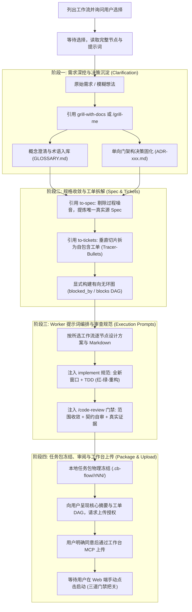

# cb-flow

先确定用户采用的工作流，再按真实节点准备可独立执行的任务包。根据节点职责使用需求澄清、规格、工单、开发或审查能力；取得用户对该版本和目标工作台的明确授权后，通过 MCP 上传至 CBWorkBench，等待用户在 Web 端手动启动。本技能只准备材料，不修改业务代码、不调用 Worker 或自动启动任务。

## 开始前：必须询问采用哪个工作流

1. 发现当前环境真实可用的工作台 MCP，调用 `workbench_list_workflows` 获取工作流名称与 ID，向用户展示候选并明确询问：“本次采用哪个工作流？”。等待用户选择后再继续；本次对话中用户已明确指定时直接沿用，不重复询问。不得自行采用默认、上次或当前页面选中的工作流。
2. 用户选择前只检查项目指令、相关代码与接入能力，不编写执行方案或节点 Markdown。没有可用的工作流查询工具时，说明接入缺口并请用户提供所选工作流的完整节点定义；未取得定义前不猜测节点。
3. 选择后调用 `workbench_get_workflow` 获取完整节点定义，并调用 `workbench_get_package_protocol` 核对材料契约。记录工作流 ID、`definition_sha256`，逐个读取任务节点的 ID、`dir_name`、执行方式、执行器、提示词、成功和失败去向及 `material_contract`。
4. 按每个任务节点已有提示词确定职责、方案、输入输出、完成条件和 Markdown 材料。节点提示词是固定要求，任务材料在此基础上补充本次需求；冲突时先澄清，不覆盖固定要求。职责不明确且影响结果时询问用户。
5. 节点材料与所选工作流的所有 `task` 节点一一对应；`start`、`end` 只控制流转。依据真实连线设计交接与返工，不固定套用“开发 → 命令测试 → 验收 → 人工”的节点组合。工作流变更后重新读取并调整方案、材料与摘要，避免沿用旧节点定义。

---

## 全流程技能联动流水线

以下能力按需求和节点职责采用；实际节点数量、分工和流转始终以用户选定的工作流为准。

---

## 阶段一：需求深挖与决策沉淀 (`grill-with-docs` / `/grill-me`)

用户选定工作流后，结合节点职责澄清影响方案的需求：

1. **反求诸己与追问对齐**：
   - 面对模糊想法、抽象描述或潜在技术风险，主动调用 `grill-with-docs` 或引导用户使用 `/grill-me` 开启交互式提问。
   - 极限场景追问：边界条件、失败路径、并发竞争、异常回滚及非功能性约束。
   - **闭环标准**：提出的每个问题，**要么在对话中由用户给出确定答复，要么通过一次可运行的代码/测试命令获得客观验证**。
2. **术语沉淀与架构决策 (ADR)**：
   - 提取领域名词写入 `GLOSSARY.md`，消除概念多义性与团队黑话。
   - 识别单向门（难以逆转的重大技术架构抉择，如核心协议变更、数据库主键设计、通信机制等），沉淀为正式 ADR（记录背景、备选方案、单向门评估、最终决策与潜在代价）。

---

## 阶段二：规格收敛与 Tracer-Bullet 拆票 (`to-spec` / `to-tickets`)

当需求与决策明确后，将研讨内容工程化收敛：

1. **规格收敛 (`to-spec`)**：
   - 彻底丢弃多轮讨论中的推演过程、试探性摇摆与闲聊噪音。
   - 沉淀为标准规格说明书（`spec.md`），明确划定 **In Scope**（必须交付）与 **Out of Scope**（坚决不做）。
   - 规范化接口、状态机模型与可断言的验收标准（Acceptance Criteria），作为后续所有步骤的唯一真实源（Single Source of Truth）。
2. **Tracer-Bullet 工单拆解 (`to-tickets`)**：
   - 严禁按技术架构分层横切（切忌只做表、只写接口）；必须切为**垂直贯穿端到端调用链的 Tracer-Bullet 小票**，每张票形成最小闭环。
   - 显式声明工单阻塞边（`blocked_by: [TICKET-ID]` 和 `blocks: [TICKET-ID]`），构建无环依赖图（DAG）。
   - **自包含保证**：每张票包含独立的输入契约、文件变更范围与可执行测试命令，任何人或模型单独拿走该票即可开工，无需翻阅前序历史。

---

## 阶段三：Worker 提示词编排与审查规范注入 (`implement` / `/code-review`)

为每个任务节点生成 `nodes/<dir_name>/prompt.md`，保留编排时填写的提示词要求并补充本次任务内容。以下 `implement` 与 `/code-review` 纪律只用于承担开发修改的 Agent 节点；只读验收节点使用审查约束，人工节点使用核验指引，其他节点按实际职责设计，不能全部套用开发流程：

1. **全新会话隔离与上下文即丢**：
   - 明确声明 Worker 在全新独立窗口中执行对应 Ticket，不预设上一张票的会话记忆；当前票交付后其上下文即可丢弃。
2. **TDD 驱动开发 (Test-Driven Development)**：
   - **红灯 (Red)**：先根据工单断言编写失败测试，运行并确认失败原因符合契约预期。
   - **绿灯 (Green)**：编写最简业务逻辑使测试通过。
   - **重构 (Refactor)**：在绿灯保护下优化结构与代码质量。
3. **以 `/code-review` 自审收尾**：
   - Worker 完工前必须对照 `/code-review` 清单逐行核验 `git diff`：
     - 范围收敛：未修改工单范围外的文件。
     - 契约完备：覆盖所有异常边界与空值保护。
     - 调试清理：移除临时日志、TODO 与硬编码。
     - 真实证据：独立执行自动化测试，捕获退出码为 0 的实际证据。

---

## 阶段四：任务包冻结、用户审阅与工作台 MCP 上传

1. **任务包生成与物理冻结**：
   - 沿用用户已选工作流，生成前核对 `definition_sha256`、完整节点及材料契约未变化。
   - 遵循 [任务包与无上下文提示词规范](references/task-package.md)，将符合 `cb.task-package/2.0` 的材料生成到当前项目的 `.cb-flow/<task-key>/rNN/`：
     - `manifest.json`：关联工作流 ID 与 `definition_sha256`、所有任务节点绑定、共同资源、输入输出契约及文件原始字节大小与 SHA-256。
     - `shared/resources/*`：共同需求背景与冻结验收基线。
     - `nodes/<dir_name>/node.md`：对应节点的职责范围、输入、工作步骤、完成条件与阻塞处理。
     - `nodes/<dir_name>/prompt.md`：根据节点已配置提示词生成的独立操作指令，按开发、测试验证、只读审查或人工等实际职责补充任务要求。
   - 测试命令由执行该节点的 Agent 根据项目和任务材料自行确定并运行，工作流不提供 `command` 配置。`result_rule = "verification"` 的节点不修改业务代码，必须生成 `outputs/test_report.json`，格式见任务包规范；输入绑定使用当前代码代次，确保返工后重新测试。
     - `nodes/<dir_name>/resources/*`：按节点职责附带的工单清单、测试用例、验收清单、JSON Schema 等普通资源。
2. **三道硬门禁守护**：
   - **门禁 1（对话授权）**：向用户展示本地任务包路径、工单 DAG、各节点材料分配与阻塞项，**请求用户明确同意上传该版本到工作台**；未获授权绝不上传。
   - **门禁 2（Web 手动启动）**：通过工作台 MCP 工具 `workbench_stage_package`（`source.mode = "local_path"`）与 `workbench_finalize_package` 上传冻结，返回任务链接或 ID。提示用户在 Web 端手动点击启动，严禁自动调用启动接口。
   - **门禁 3（人工审核）**：若所选工作流包含人工节点，由用户在 Web 端核验并决定通过或退回；实际执行顺序和返工路径遵循所选工作流。

---

## 交付表达

用简短、清晰的中文汇报：
1. 用户已选工作流名称、ID、节点分工及与方案和 Markdown 材料的对应关系；
2. 本次实际生成的需求、规格或工单材料，以及阻塞项；
3. 本地任务包路径与当前修订版本号；
4. 明确询问：“是否同意将此版本任务包上传至开发工作台？”，提示用户上传后需在 Web 端手动启动。
