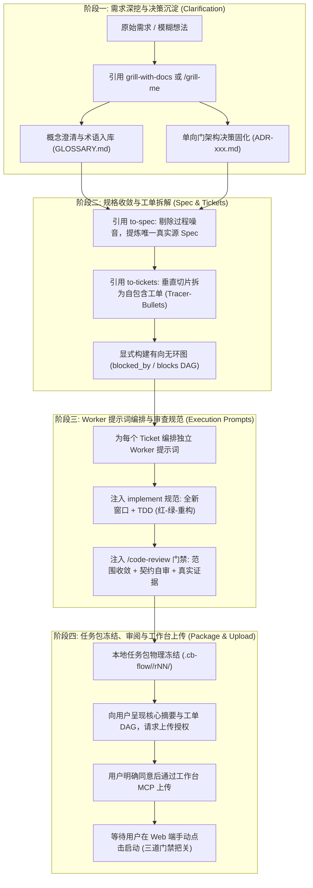

# cb-flow

作为主 Agent 的工作流总编排规范，贯穿从需求澄清到工作台任务派发的全流程。通过标准化技能链（`grill-with-docs` / `/grill-me` → `to-spec` → `to-tickets` → `implement` + `/code-review`），把开放式的开发需求收敛为结构严密、可独立执行的任务包；在取得用户对该版本和目标工作台的明确授权后，通过 MCP 上传至 CBWorkBench，等待用户在 Web 端手动启动。

---

## 全流程技能联动流水线

---

## 阶段一：需求深挖与决策沉淀 (`grill-with-docs` / `/grill-me`)

在进入任何编码或方案设计前，先消除需求中的模糊地带：

1. **反求诸己与追问对齐**：
   - 面对模糊想法、抽象描述或潜在技术风险，主动调用 `grill-with-docs` 或引导用户使用 `/grill-me` 开启交互式提问。
   - 极限场景追问：边界条件、失败路径、并发竞争、异常回滚及非功能性约束。
   - **闭环标准**：提出的每个问题，**要么在对话中由用户给出确定答复，要么通过一次可运行的代码/测试命令获得客观验证**。
2. **术语沉淀与架构决策 (ADR)**：
   - 提取领域名词写入 `GLOSSARY.md`，消除概念多义性与团队黑话。
   - 识别单向门（难以逆转的重大技术架构抉择，如核心协议变更、数据库主键设计、通信机制等），沉淀为正式 ADR（记录背景、备选方案、单向门评估、最终决策与潜在代价）。

---

## 阶段二：规格收敛与 Tracer-Bullet 拆票 (`to-spec` / `to-tickets`)

当需求与决策明确后，将研讨内容工程化收敛：

1. **规格收敛 (`to-spec`)**：
   - 彻底丢弃多轮讨论中的推演过程、试探性摇摆与闲聊噪音。
   - 沉淀为标准规格说明书（`spec.md`），明确划定 **In Scope**（必须交付）与 **Out of Scope**（坚决不做）。
   - 规范化接口、状态机模型与可断言的验收标准（Acceptance Criteria），作为后续所有步骤的唯一真实源（Single Source of Truth）。
2. **Tracer-Bullet 工单拆解 (`to-tickets`)**：
   - 严禁按技术架构分层横切（切忌只做表、只写接口）；必须切为**垂直贯穿端到端调用链的 Tracer-Bullet 小票**，每张票形成最小闭环。
   - 显式声明工单阻塞边（`blocked_by: [TICKET-ID]` 和 `blocks: [TICKET-ID]`），构建无环依赖图（DAG）。
   - **自包含保证**：每张票包含独立的输入契约、文件变更范围与可执行测试命令，任何人或模型单独拿走该票即可开工，无需翻阅前序历史。

---

## 阶段三：Worker 提示词编排与审查规范注入 (`implement` / `/code-review`)

在生成任务包的 `prompts/worker-<id>.md` 时，必须将 `implement` 流程与 `/code-review` 纪律作为硬性约束注入提示词：

1. **全新会话隔离与上下文即丢**：
   - 明确声明 Worker 在全新独立窗口中执行对应 Ticket，不预设上一张票的会话记忆；当前票交付后其上下文即可丢弃。
2. **TDD 驱动开发 (Test-Driven Development)**：
   - **红灯 (Red)**：先根据工单断言编写失败测试，运行并确认失败原因符合契约预期。
   - **绿灯 (Green)**：编写最简业务逻辑使测试通过。
   - **重构 (Refactor)**：在绿灯保护下优化结构与代码质量。
3. **以 `/code-review` 自审收尾**：
   - Worker 完工前必须对照 `/code-review` 清单逐行核验 `git diff`：
     - 范围收敛：未修改工单范围外的文件。
     - 契约完备：覆盖所有异常边界与空值保护。
     - 调试清理：移除临时日志、TODO 与硬编码。
     - 真实证据：独立执行自动化测试，捕获退出码为 0 的实际证据。

---

## 阶段四：任务包冻结、用户审阅与工作台 MCP 上传

1. **任务包生成与物理冻结**：
   - 遵循 [任务包与无上下文提示词规范](references/task-package.md)，将材料生成到当前项目的 `.cb-flow/<task-key>/rNN/`：
     - `manifest.json`：关联版本、工单 DAG、Worker 分工及文件哈希。
     - `task.md`：收敛后的 Spec 核心背景与边界。
     - `development.md`：按 Tracer-bullet 编排的工单开发清单。
     - `tests.md`：包含真实命令与断言的测试用例。
     - `acceptance.md`：自动验收（Codex 只读审查）与人工审核标准。
     - `prompts/worker-*.md`：注入了 `implement` 与 `/code-review` 纪律的独立提示词。
     - `prompts/verifier.md`：Codex 只读沙箱验收提示词。
2. **三道硬门禁守护**：
   - **门禁 1（对话授权）**：向用户展示本地任务包路径、工单 DAG、Worker 分工与验收标准，**请求用户明确同意上传该版本到工作台**；未获授权绝不上传。
   - **门禁 2（Web 手动启动）**：通过真实工作台 MCP 工具（如 `workbench_submit_task`）上传材料，返回任务链接或 ID。提示用户在 Web 端手动点击启动，严禁自动调用启动接口。
   - **门禁 3（人工审核）**：工作台自动循环（Worker 开发 → 测试独立运行 → Codex 只读验收）通过后，由人类工程师在 Web 端最终核验结项，结项后可联动 `pr-retro` 编写 PR 并推进“只改环境不改代码”的复盘。

---

## 交付表达

用简短、清晰的中文汇报：
1. 需求与决策收敛状态（是否已产生 `GLOSSARY.md` 与 ADR）；
2. Spec 与 Tracer-bullet 工单拆解概要及阻塞 DAG 关系；
3. 本地任务包路径与当前修订版本号；
4. 明确询问：“是否同意将此版本任务包上传至开发工作台？”，提示用户上传后需在 Web 端手动启动。
