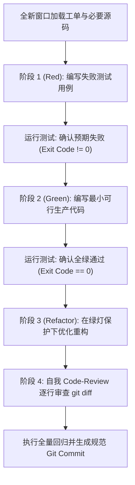

# implement

为每一个工单分配一个**全新、独立的执行窗口**。利用票内完备的自包含上下文，采用测试驱动开发（TDD）推进代码实现，严密守护改动范围；并在交付前通过严格的自我代码审查（Code-Review）收尾，确保单票质量达标。**当完成当前票的实现与提交后，其会话记忆可安全抛弃，不干扰后续工单**。

## 核心原则

1. **全新会话隔离 (Fresh Context Window)**：每张票必须在全新或无污染的上下文会话中执行。不依赖上一张票的中间记忆，避免注意力衰减与幻觉积累。
2. **测试先行 (TDD: Red-Green-Refactor)**：不写无测试保护的生产代码。必须先写能捕获工单契约的失败测试，验证变红，再写最小实现变绿，最后重构。
3. **自我审查门禁 (Self Code-Review)**：完工前必须主动调用 `git diff`，站在资深评审者视角逐行审查，确保没有多余改动、无调试遗留、无契约遗漏。
4. **上下文即用即丢**：完成单票交付后，所有中间思考与探索日志均可丢弃，只需保留 Git 提交记录与代码本身。

---

## 交付物

| 交付物 | 目标形式 | 说明 |
| :--- | :--- | :--- |
| **功能代码与测试** | 工作区源码文件 | 包含新增/修改的业务逻辑实现与高覆盖率单元/集成测试 |
| **测试通过凭证** | 终端执行日志 | 运行完整自动化测试套件退出码为 0 的实际证据 |
| **原子提交** | Git Commit | 符合规范的结构化提交，清晰对应目标工单 ID |

---

## 标准执行流



### 1. 独立窗口启动
- 读取当前工单（`TICKET-xxx`）中的目标、输入输出契约及测试验证命令。
- 仅读取该工单明确提及的相关代码文件与现有测试，避免加载无关冗余代码。

### 2. TDD 闭环开发
- **红灯阶段 (Red)**：根据工单的验收断言，在 `tests/` 下建立对应测试用例。执行测试，确保测试确实失败，且失败原因是因为“目标逻辑未实现”，而非测试代码语法错误。
- **绿灯阶段 (Green)**：在对应源文件中编写最精简、直接的业务代码，使测试恰好全量通过。
- **重构阶段 (Refactor)**：保持测试全绿的前提下，清理重复代码、提炼内部辅助函数、优化变量命名与类型定义。

### 3. Code-Review 收尾审查清单
在宣布完工并提交前，必须对照以下审查清单：

- [ ] **范围收敛**：运行 `git status` 与 `git diff`，是否有修改工单范围之外的无关文件？
- [ ] **契约完备**：工单中规定的边界条件、异常分支与空值防护是否全部被覆盖并有测试佐证？
- [ ] **调试清理**：是否移除了所有的临时 `console.log`、`print`、注释掉的代码或本地硬编码凭证？
- [ ] **环境无损**：是否引入了未在 `package.json` / 项目配置中声明的非标依赖？
- [ ] **回归保障**：运行项目既有测试套件，确保没有破坏任何存量现有功能。

### 4. 生成原子提交
提交信息格式规范：
```text
feat(scope): [TICKET-001] 完成基础认证调用链

- 建立端到端鉴权中间件与解析链路
- 补充测试用例，覆盖正常登录与非法 Token 拒绝场景
- 自动化测试 npm test 全部通过 (Exit Code: 0)
```

---

## 退出与完成标准

- [ ] 针对本工单的测试命令独立运行通过，退出码为 0。
- [ ] 全量回归测试通过，无存量破坏。
- [ ] `git diff` 审查完成，无工作区脏文件与多余改动。
- [ ] 代码已通过 Git 原子提交封包，本轮会话可安全重置或切换。
