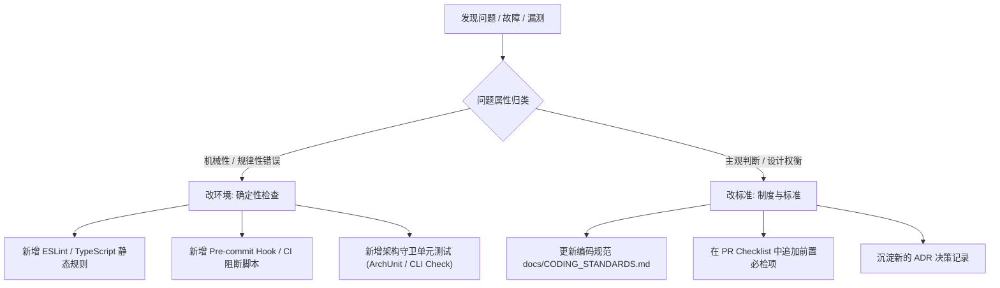

# pr-retro (PR → Retro)

涵盖从特性交付完成后的 Pull Request（PR）正文撰写，到事故与迭代缺陷的工程复盘（Retrospective）全流程。通过客观证据和风险分类实现高效代码合并；并在复盘环节坚决执行**“复盘时只改环境，不改代码”**的工程铁律，持续提升系统防呆与质量内建能力。

## 核心原则

1. **最小可视证据 (Minimal Visual Evidence)**：拒绝口头保证。PR 中必须包含客观的终端执行日志、退出码、前后对比数据或最小运行截图。
2. **决策门禁分类 (One-Way vs Two-Way Door)**：显式区分单向门（难以逆转、迁移成本高）与双向门（可轻松回滚或热切换）决策，让评审人将精力聚焦在高风险决策上。
3. **复盘只改环境，不改代码**：
   - 发现漏测或故障时，“修复那一行业务代码”只算救火，不算复盘。
   - **机械性错误**：必须沉淀为环境与工具链的**确定性自动化检查**（Linter、Git Hook、CI Pipeline、架构单测）。
   - **判断类问题**：必须固化为团队**编码标准、架构规范或合并 Checklist**。

---

## 交付物

| 交付物 | 目标位置 | 说明 |
| :--- | :--- | :--- |
| **PR 正文草案** | `docs/pull-requests/PR-<name>.md` (或 PR 提交描述) | 包含背景、可视证据、前后对比、单向门分析及回退方案的完整说明 |
| **复盘行动项与环境规则** | Linter 配置 / CI 脚本 / Git Hooks / 自动化测试 | 将机械失误转化的自动化防御机制 |
| **团队编码标准 / Checklist** | `docs/CHECKLISTS.md` / `docs/CODING_STANDARDS.md` | 针对非机械性判断问题的标准沉淀 |

---

## 1. PR 正文结构规范

PR 编写必须直接回答审查者关心的核心风险点与验证凭据：

```markdown
# [PR 标题: 简短动宾短语]

## 1. 变更摘要与动机 (Summary)
- 关联工单: TICKET-xxx / Spec: docs/specs/xxx.spec.md
- 解决了什么问题？核心行为改变是什么？

## 2. 行为前后对比 (Before vs After)

| 场景 / 维度 | 变更前行为 (Before) | 变更后行为 (After) |
| :--- | :--- | :--- |
| **正常调用** | 单次查询循环发起 50 次请求 | 采用批量接口合并为 1 次请求 |
| **超时/异常** | 无捕获直接抛 500 导致进程崩溃 | 触发重试并在最终失败时平滑降级 |

## 3. 决策门分类 (Door Classification)
- [ ] **双向门 (Two-Way Door)**: 本改动支持功能开关（Feature Flag）热关闭，回滚无数据迁移风险。
- [x] **单向门 (One-Way Door)**: 涉及数据库核心索引变更及字段重命名。
  - **回滚与补救计划**: 保留旧字段写入并开启双写，已备好数据库降级迁移脚本 `rollback-v2.sql`。

## 4. 最小可视证据 (Minimal Visual Evidence)
```bash
# 测试套件执行结果证据
$ npm test -- tests/core/parser.test.ts
 PASS  tests/core/parser.test.ts
  ✓ should parse input correctly (12ms)
  ✓ should reject malformed payload with 400 (5ms)

Test Suites: 1 passed, 1 total
Tests:       2 passed, 2 total
Exit code: 0
```
*(若涉及 UI/页面，在此处贴上变更前后的直观对比截图或动图)*

## 5. 合并前 Checklist
- [ ] 所有关联测试均在本地/CI 独立通过
- [ ] 无冗余改动与格式污染 (`git diff` 已自查)
- [ ] 涉及单向门变更已获架构师/负责人二次确认
```

---

## 2. 复盘（Retro）落地机制：只改环境，不改代码

当出现缺陷逃逸、测试未覆盖、或者合并后告警时，立即启动复盘：



### 规则分类与落地标准

#### 规则 A：机械性错误（Mechanical Errors）
*定义*：可以通过 AST 分析、语法解析、正则表达式、环境检查或单元测试捕获的错误。
- **典型表现**：漏写 `await`、未声明必填属性、循环依赖、日志未脱敏、提交了临时文件。
- **严禁整改措施**：口头提醒“下次大家注意写 await”。
- **必须整改措施**：
  - 引入 `@typescript-eslint/no-floating-promises` 规则并设为 `error`。
  - 在 CI 或 Husky pre-commit hook 中加入硬性静态拦截，未通过直接中断提交。

#### 规则 B：判断类问题（Judgment Errors）
*定义*：依赖业务场景权衡、抽象设计、跨模块边界或数据语义，无法纯靠静态工具判断的问题。
- **典型表现**：模块职责划分不合理、降级兜底逻辑不符合业务期望、未评估并发死锁风险。
- **严禁整改措施**：泛泛而谈“加强团队业务理解”。
- **必须整改措施**：
  - 将此设计要点抽象为标准 Checklist，加入 PR 模板的必勾选项目。
  - 将正反案例记录入项目开发规范 `docs/CODING_STANDARDS.md`。

---

## 退出与完成标准

- [ ] PR 正文具备完整的最小可视证据与前后对比表格。
- [ ] 决策门属性（单向门/双向门）已明确标注并附带回滚评估。
- [ ] 复盘产出的每一项改进均落实到了“工具链配置、CI 脚本、测试用例或规范文档”中，不保留任何口头承诺。
