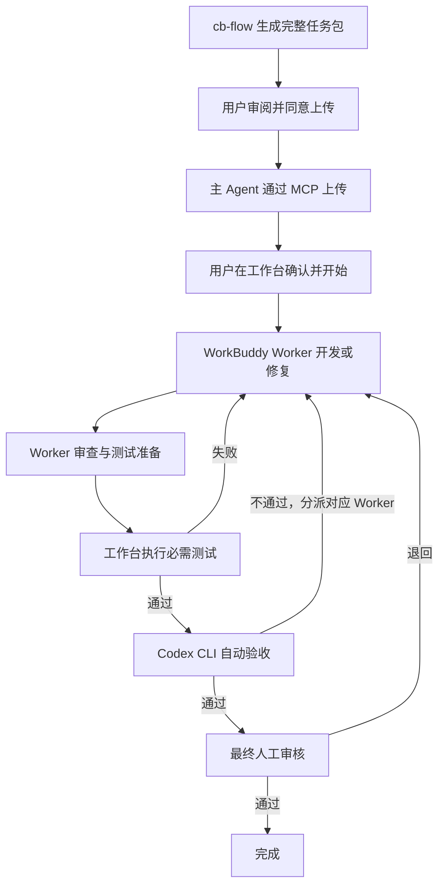
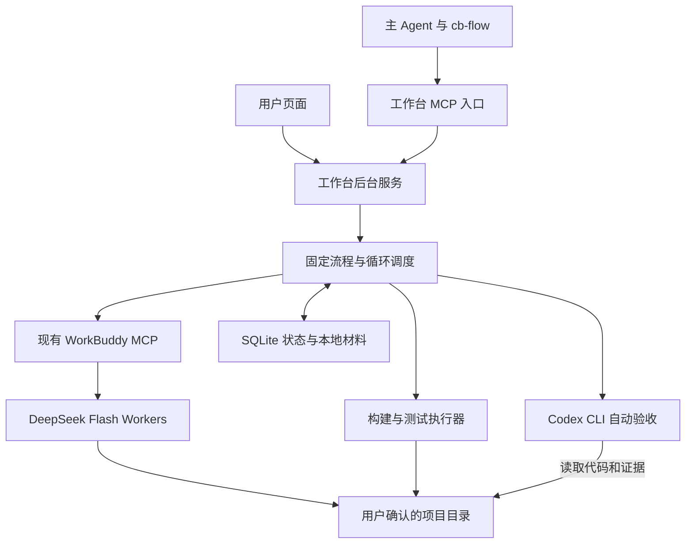

# 多 Agent 开发工作台：从零版总体架构与使用流程

> 状态：初版待审核，已按补充需求修订。本文是设计，不代表功能已经实现。
> 从零设计，不复用历史代码或流程框架；本方案不要求复用或迁移历史项目。

## 1. 第一版定位

主 Agent 在当前项目中使用 `cb-flow` 制定任务，生成各 Worker 与验收者的独立提示词、开发清单、测试用例、测试标准和验收标准。先向用户展示完整任务包，经用户同意上传后通过 MCP 提交。用户再在工作台手动确认并开始，工作台此后按这些材料持续调用 Worker，执行、测试和修复。

**Worker 固定通过已安装的 WorkBuddy MCP 调用 `deepseek-v4-flash`；自动验收固定调用 Codex CLI。只有 Codex 自动验收通过，才能到达最终人工审核门禁。**

第一版为单机、单用户、一个固定流程，同一时间执行一个任务，Worker 串行调用。不做 CLI 配置界面、模型选择器、项目登记、角色市场、流程画布、通用运行时插件平台或自动发布。

工作台负责推进既定流程，不重新制定业务目标，不替换主 Agent 提交的标准。

## 2. 开发者怎样使用

### 2.1 一次准备，之后在聊天中提交

启动工作台，把工作台 MCP 接入主 Agent，安装配套的任务提交 Skill `cb-flow`。工作台复用本机 WorkBuddy MCP 和 Codex CLI，启动时检查能否调用，不要求用户重新填写命令参数或选择模型。

无需事先登记项目或 Git 地址。主 Agent 提交当前对话的工作目录，工作台识别对应 Git 仓库，作为任务默认值。用户可以在启动确认页修改目录；修改后重新识别仓库，不能沿用旧目录的代码基准。若任务材料依赖旧项目，需要主 Agent 更新材料后再确认。

### 2.2 第一步：与主 Agent 把任务说清楚

例如：

> 使用 $cb-flow，给当前项目的订单列表增加供应商筛选，保持现有分页和权限行为。生成任务清单、测试用例、验收标准以及 Worker 和验收者的提示词，先给我审阅，同意后再上传工作台。

主 Agent 阅读实际代码，解决业务歧义，使用 Skill 准备完整任务包。每个 Worker 的提示词说明职责、修改范围、输入材料、执行要求、完成条件和输出格式。

开发、审查、测试、修复可以使用不同提示词，但第一版全部由固定的 WorkBuddy 模型执行。主 Agent 同时制定 Codex 自动验收提示词和标准，执行过程中不再临时另定标准。每份提示词必须在没有原聊天上下文时仍可理解，包含背景、职责范围、材料入口、执行要求、判定条件和结果格式；本轮代码与报告由工作台派发时明确提供。

`cb-flow` 先在本地保存实际材料并展示给用户。上传同意绑定具体版本和目标工作台；任务内容、目录或目标变化后需重新确认。只同意生成材料或方案不代表同意上传。接口不可用时保留本地包并说明未上传，不伪造工具调用。

上传前同意、工作台手动启动、最终人工审核是三个独立门禁。

### 2.3 第二步：在工作台手动确认并开始

主 Agent 提交后返回任务编号和详情链接，任务状态为“待启动确认”。页面展示目标、开发清单、各 Worker 提示词、测试和验收标准、默认目录及 Git 状态、执行模型和异常停止策略。

用户核对材料，必要时修改目录，点击“确认并开始”。**聊天中的同意、模型提交任务或 MCP 调用均不能代替这个页面操作。** 模型没有启动任务或最终人工审核通过的工具。

任务内容需要修改时，由主 Agent 提交修订版。启动时冻结用户确认的材料和提示词，工作台按该版本执行。

### 2.4 第三步：工作台持续调用 Worker

用户看到的状态示例：

> 第 2 轮修复：分页回归测试未通过，正在调用修复 Worker。下一步：重新审查和测试。

工作台传递阶段结果和问题，调用对应 Worker。普通审查问题、测试失败和 Codex 验收不通过均自动安排修复，用户不必每轮发送“继续”。

用户可以查看阶段、执行轮次、已返回报告和失败原因，也可以让主 Agent 查询。第一版显示阶段级进度，不承诺实时展示 Worker 的每一步工具调用。

关闭原聊天不应影响任务；工作台和所需运行环境必须保持运行。服务退出、电脑休眠或环境故障后，先核对现场，再决定如何继续。

### 2.5 第四步：Codex 先验收，用户最后审核

必需自动测试通过后，工作台调用 Codex CLI，传入原始任务、冻结的验收标准、代码差异、历史问题和测试证据。

| Codex 结论 | 工作台动作 |
|---|---|
| 通过 | 核对证据和代码版本后进入最终人工审核 |
| 不通过且可修复 | 把问题及对应标准交给指定 Worker，继续循环 |
| 无法判断或受阻 | 转待处理，说明缺少的材料或环境，不视为通过 |

进入最终人工审核后，用户查看完成情况、代码差异、测试报告、Codex 验收结论和人工检查步骤，选择“审核通过”或填写原因“退回修改”。

人工退回后再次循环，仍须重新取得测试证据和 Codex 通过结论，才能回到人工审核。第一版由开发者自行合并代码和发布。

异常待处理可以发生在任一执行阶段。它不等于最终人工审核，也不能用来绕过 Codex 验收。

## 3. 任务包是唯一执行契约

| 材料 | 必需内容 |
|---|---|
| 任务说明 MD | 目标、背景、范围、排除项、业务约束 |
| 开发清单 | 开发项 ID、执行顺序、预期改动、完成条件 |
| Worker 提示词 | Worker ID、职责、修改范围、输入输出和完成条件 |
| 测试用例 | 用例 ID、关联需求、前置条件、步骤、输入和预期结果 |
| 测试标准 | 必需检查、执行命令、报告位置、通过条件、环境要求 |
| Codex 验收提示词与标准 | 逐项检查要求、阻断条件、所需证据、结果格式 |
| 人工审核标准 | 用户需要实际检查的操作、效果和业务判断 |
| 默认上下文 | 当前对话工作目录、仓库和代码基准信息 |
| 执行策略 | 单次超时、异常处理、避免无限消耗的限制 |

采用 Markdown 正文加少量结构化字段。正文供人和 Agent 理解；ID、阶段、目标 Worker 和必需检查用于确定性调度。

每次调用组合“原始 Worker 提示词 + 本次输入 + 上一轮问题和证据”。工作台可以补充上下文，不能改写业务职责或降低标准。

Codex 不通过时返回问题、关联标准 ID、证据、目标 Worker ID 和修复要求。目标必须属于任务包预先定义的 Worker；工作台校验后派发，不接受任意新增执行者或工具调用。无效输出、未知 Worker 或缺乏证据的通过结论不能推进门禁。

测试用例分为已可执行、需要 Worker 编写自动化测试、人工检查三类。只有启动前定义为人工检查的事项可以留到最终人工审核；不能因为自动检查失败而临时改为人工检查。

### cb-flow 的交付与上传职责

Skill 负责读取当前项目，生成完整任务材料并自检，不直接修改业务代码或调用 Worker 开发。默认输出到当前项目的 `.cb-flow/<task-key>/rNN/`，修订生成新版本，不覆盖旧材料。

任务包包括 `manifest.json`、`task.md`、`development.md`、`tests.md`、`acceptance.md`、每个 Worker 的提示词文件和 `prompts/verifier.md`。清单记录材料版本、需求与开发项及标准的关联、Worker 分工和文件哈希；这是本地材料约定，上传时按真实 MCP 契约无损映射。

提示词不能依赖“上文”“继续刚才任务”等聊天信息。除必要背景外，必须说明工作台需要提供的目录、任务包入口、当前代码状态、阶段报告和上一轮问题；必需输入缺失时返回受阻，不猜测。

用户同意后，通过真实工作台 MCP 上传全部正文与提示词，不能只传本地路径并假定服务能读取。上传回执记录真实任务 ID、版本和状态；支持读回时核对完整性。调用结果不明时先查询，避免重复创建；上传完成只到待启动确认。

## 4. 最小技术架构

### 4.1 技术与工程选择

采用 **TypeScript + Node.js 24 + 内置 SQLite + 本地文件 + 简单 Web 页面**。

一个工程、一个常驻后台服务。使用 Node 内置 HTTP 和文件能力，页面使用轻量 HTML/CSS/TypeScript，暂不引入大型 UI 组件库或状态管理框架。页面定期查询状态即可，无需先做 WebSocket、消息队列或微服务。

主要新增运行依赖为 MCP SDK 及其所需校验依赖；TypeScript 属于开发工具依赖。WorkBuddy MCP 和 Codex CLI 复用已安装环境，不在工作台内重新实现。

只需四部分：入口与页面、流程控制器、执行模块、存储模块。它们是同一服务中的模块，不是独立服务，也不先建设通用适配器平台。

### 4.2 SQLite 会引入额外依赖吗

**使用 Node 内置的 `node:sqlite`，不需要安装数据库服务、SQLite 命令行、第三方驱动或 ORM。** 数据保存在本机文件中。

2026-10-28 本机检查：默认 PATH 中的 Node 为 `18.20.8`，不支持导入 `node:sqlite`；本机另有 Node `24.22.1`，已实际创建内存数据库并查询成功，返回 SQLite `3.53.4`。

因此启动器必须固定或校验支持的 Node，不能假定命令 `node` 指向合适版本。本次未升级系统 Node、未安装依赖；产品也不应把某个应用内部的缓存路径写死为安装路径。

SQLite 只存状态、材料版本、执行记录和验收结论；Markdown、日志和报告仍存普通文件。纯 JSON 看似更轻，但重试与恢复时需要自行处理一致性，保留内置 SQLite 更可靠且不增加独立部署组件。

## 5. MCP 与 CLI 怎样调用

### 5.1 主 Agent 调用工作台 MCP

提供提交、修订、查询和读取结果等少量工具。提交立即返回任务 ID 和页面地址，不让一个 MCP 请求等待整个开发过程。

启动和最终人工审核只允许用户在页面完成。MCP 入口不暴露这两类工具；后台使用本机访问凭证、来源校验和独立的用户操作通道。不能只靠提示词或隐藏接口控制权限。

本机可用 stdio 薄桥接转发到常驻后台。不同聊天入口共用同一后台状态，不各自创建调度器。

### 5.2 工作台调用已安装 WorkBuddy MCP

已核对现有 `run_workbuddy_task` 工具及其本机源码，支持提示词、目录、模型和超时参数。第一版固定传入：

| 参数 | 内容 |
|---|---|
| `prompt` | 对应 Worker 提示词和本轮上下文 |
| `cwd` | 用户手动确认的执行目录 |
| `model` | `deepseek-v4-flash` |
| `timeoutMs` | 本轮超时 |

工作台自身作为 MCP 客户端，复用已安装服务的启动信息和环境建立连接。当前聊天能够调用它，不代表新工作台进程自动拥有这个连接；这一步需要实现，但无需建设 CLI 配置界面，也不复制整个主 Agent 配置。

现有 WorkBuddy MCP 内部调用 CLI，由该组件负责；工作台不再做一套 WorkBuddy CLI 直连。固定模型时，还需避免继承自动换模型的配置，防止过载后静默使用其他模型。

现有工具为单次请求等待结果，没有独立状态查询、取消工具或逐步输出流。因此第一版显示阶段级进度。“停止后续执行”表示当前调用返回或超时终止后停止派发；此之前保持“正在停止”。连接断开不能证明 Worker 已结束，需核对后再运行下一次。

### 5.3 Codex CLI 承担主验收角色

采用 Codex 非交互调用，不做 CLI 配置页面，复用本机登录和默认模型设置，单次指定目录、完整验收上下文、结果格式与所需权限。

本机帮助信息已确认 `codex-cli 0.147.0` 支持 `exec`、工作目录、JSON 事件、输出 Schema 和只读沙箱选项。本次未调用模型做真实验收，认证、网络、模型执行和权限边界仍需端到端验证。

这里的“调用主 Agent”是调用 **Codex 承担主验收角色**，并非自动唤醒最初的聊天。独立 CLI 调用不会自动继承原聊天内容；第一版通过完整任务包、历史问题和证据显式重建验收上下文，不依赖原对话的隐含记忆。

验收以读取代码和证据为主，不修改业务代码。缺少验证时退回给测试 Worker 或工作台执行器。除进程权限外，还需限制验收会话的外部工具权限，不能把只读沙箱当成所有 MCP 工具都已只读的证明。

结果包含结论、材料版本、代码版本、逐项检查、证据引用和待处理问题。进程退出成功不等于业务验收通过。

## 6. 循环与门禁规则

正常状态：

**待启动确认 → 排队 → 准备 → Worker 执行 → 自动测试 → Codex 自动验收 → 最终人工审核 → 完成。**

审查存在阻断问题、测试失败或 Codex 验收不通过时，派发对应 Worker 后继续循环。代码变化后，需要重新获得针对该版本的必需测试和验收证据。

不再以“修复三次”作为正常结束条件。正常情况下持续循环直到 Codex 通过。但无限调用不保证收敛，建议保留单次超时、总时长或调用次数预算，以及相同问题反复出现的无进展检测。具体阈值待实施时确定，并在启动页展示。

触发限制只进入异常待处理，用户可处理后继续，不能因此进入最终人工审核或认定任务完成。

| 情况 | 处理 |
|---|---|
| 可修复的审查、测试、验收问题 | 自动调用对应 Worker |
| 业务歧义、标准冲突或扩大范围 | 主 Agent 修订材料，用户重新确认 |
| 登录、网络或测试环境故障 | 有限重试后待处理，保留原因 |
| 超预算或长期无进展 | 异常停止，等待用户决定继续策略 |
| 用户停止 | 当前调用结束或确认终止后停止派发 |
| 服务重启、调用结果不明 | 核对执行现场，禁止盲目重复运行 |
| 人工退回 | 记录原因，再次循环并通过 Codex 验收 |

最终人工审核的进入条件：材料仍是用户确认版本、开发清单完成、必需自动检查实际通过、Codex 明确通过且无未解决阻断问题，全部证据对应当前交付代码。

## 7. 目录、代码与验证证据

### 7.1 自动取默认值，不猜测路径

提交 Skill 获取当前对话实际工作目录并显式传入。工作台不使用自己的进程目录作为用户目录，也不假定 MCP 自动携带原聊天 cwd。

工作台验证绝对路径并识别对应 Git 根目录，二者可以不同，例如从仓库子目录发起任务。展示基准提交和工作区状态；未找到 Git 时提示选择有效仓库，不伪造默认值。

目录改变后重新核对，任务提交和实际启动时都检查代码状态，防止排队期间基准变化未被发现。

### 7.2 初版直接在确认目录中执行

为保持简单，初版不强制创建 worktree，直接在用户确认目录中串行执行。修改会落在该目录，不能声称已有工作区隔离。

启动前记录现有差异、相关文件基线和任务范围。不自动清理、覆盖或提交既有修改；与本次修改重叠且不能区分时，停在启动检查，由用户处理。任务运行时不应同时编辑同一范围；检测到外部变化后先核对，不沿用旧证据。

第一版不自动 Git 提交、重置、合并或推送。现有 WorkBuddy MCP 源码默认允许跳过权限确认，提示词和路径声明不构成沙箱。工作台需要展示实际执行范围和能力边界，不能承诺未实现的权限隔离。

### 7.3 用实际执行结果判断通过

Worker 可以编写测试并分析失败，工作台独立运行任务包中确认的必需命令，记录时间、退出码、报告和代码状态。未执行、跳过、未发现预期测试或环境失败均不能算通过。

Worker 不能静默降低测试基线或修改验收预期。新增检查可以补充，降低标准必须修订材料并由用户重新确认。

代码版本不能只用 Git HEAD 表示，因为修改可能尚未提交。验收快照还需关联工作区差异及相关文件内容摘要，覆盖参与验收的新增文件。代码再次变化后，相关测试与验收证据失效。

每次执行保存任务包版本、Worker ID、实际提示词、输入摘要、返回结果和错误。自动验收与人工审核分别记录；重试、修订和退回不覆盖旧结果。

派发前持久化执行意图，重复请求使用幂等控制。服务恢复后先核对未完成调用。日志或报告截断、缺失时标明证据不完整，不当作完整验证。

## 8. 界面和第一版交付标准

只需要两个主要页面：

1. **任务列表：** 待确认、排队、执行、待处理、最终人工审核和已结束任务。
2. **任务详情：** 完整材料、目录确认、手动启动、轮次和报告、停止后续执行、人工通过与退回。

运行环境检测作为状态信息展示，不增加项目登记、CLI 或模型配置页面。

第一版以真实任务闭环为交付标准：cb-flow 生成完整材料，用户同意后主 Agent 通过 MCP 上传；用户修改或确认默认目录并手动启动；固定 WorkBuddy 模型执行不同提示词；失败自动修复；真实测试通过后调用 Codex；Codex 不通过继续循环，通过才开放人工审核；人工退回后可再次闭环。

开发前补做两条小型实测：现有 WorkBuddy MCP 固定模型执行任务，Codex CLI 按规定格式完成只读验收。当前只核对了接口、源码、本机 CLI 帮助和 SQLite，没有执行开发任务、真实模型验收或修改运行环境配置。
